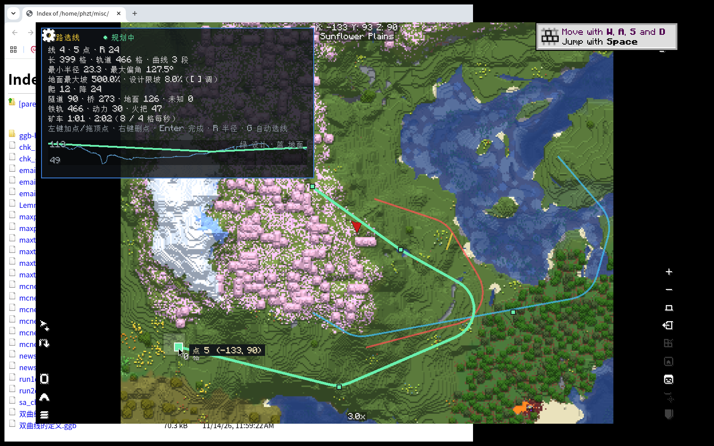
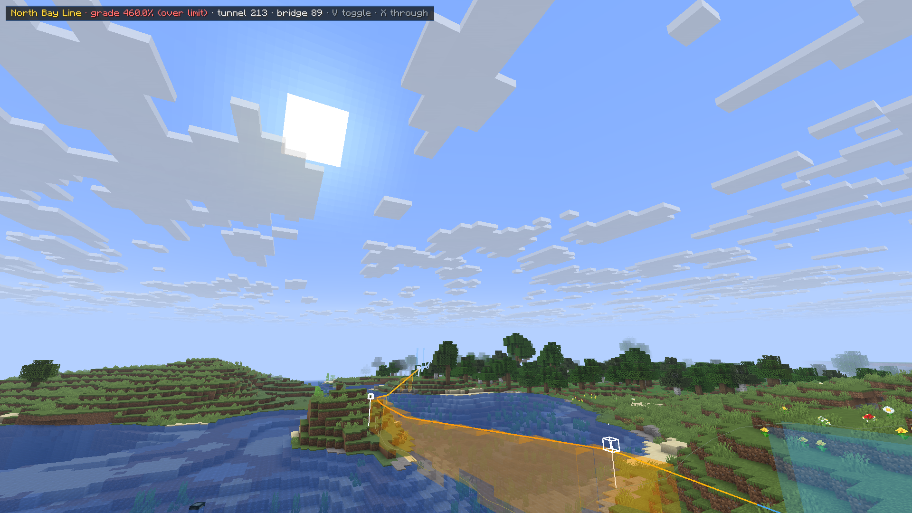
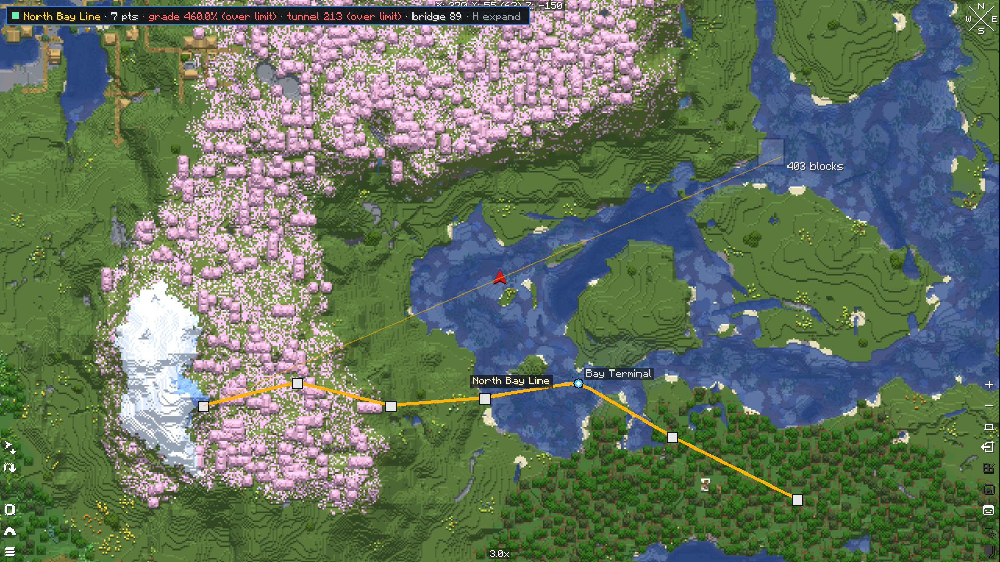

# Rail Planner — railway alignment planner (Fabric 26.3)

[中文](README.md) · English

A railway alignment tool that lives inside **Xaero's World Map**: click a few times on the map to draw the line, and the mod rounds the polyline into "tangent — circular curve — tangent" the way railway engineering does it, rasterises it onto blocks to get a running line you can actually lay, and reports length, grade, tunnels/bridges, materials and minecart travel time.

Close the map when you're done and the line still stands in the **3D world**: one design-elevation line, one terrain line, and tunnels and bridges fenced off with translucent faces over the volume that "must be dug / must be bridged" — tunnels blue, bridges orange. One walk along the route and you know where to dig and where to build. While editing, every point you clicked is marked too; lock them with `L` and a slip of the hand can't drag one out of place.

Every point you click also carries a **Y (elevation)**: by default it's the height of the highest block in that column, and **double-clicking a vertex** lets you change it — the same box also gives the point a name and a kind (station, curve control point, tunnel portal, bridge, signal, plain), each drawn as its own shape on the map and in the world. A line's own name and colour live one double-click away on the panel's name row (12-colour swatches plus a hue bar, or plain RGB); and to add a point in the middle of a line that's already drawn, **Ctrl + click** on it.

Since 0.6.0 it is **two-sided**: drop the same jar on the server and the server stores one copy per player by UUID (players can't see each other's), while the local copy stays. When both sides changed the same route, the screen asks you route by route which side to keep. Change machines or reinstall the client and the routes are still there. It also takes updating into its own hands — finds a new version, downloads it, verifies the sha256 GitHub publishes, and replaces the jar in `mods` in place; the panel gains a "Restart now（立即重启）" button.

- Target: **Minecraft 26.3 + Fabric Loader 0.19.5** (Java 25)
- **Two-sided**: without the server mod it's purely local; with it the server keeps one copy per UUID while the local copy stays, and when both sides changed, it asks you route by route which side to keep
- The client **must have Xaero's World Map ≥ 1.47**; the server needs only Fabric API, not Xaero
- No Xaero code is modified or repackaged — the mod only hooks into its map screen with a mixin
- Current version **0.8.0**



## Install

**Client**: Fabric 26.3 + **Fabric API** + **Xaero's World Map ≥ 1.47**; drop `railplanner-0.8.0.jar` into `mods/`. Mod Menu is optional (it works without it — press `U` for the settings page).

**Server (optional)**: drop the same jar into the server's `mods/`; nothing to configure. The server only wants Fabric API — **no Xaero, and no client mods**. Without it you can still join; the data just stays on your machine.

## Use

Enter a world and press `B` to open the map in planning mode; a few left clicks and you have a line, `Enter` saves it.

| Default key | What it does |
|---|---|
| `B` | Open the map in planning mode / toggle planning ↔ read-only while the map is open |
| Left / right click | Add a point, drag a vertex / delete a point |
| Ctrl + left-click on a line | Insert a point between two existing ones (snapped onto the line, shape unchanged) |
| Double-click a vertex | Change that point's Y / name / kind: Tab moves rows, ← → cycles the kind, Enter confirms |
| Double-click the panel's name row | Change this line's name and colour (swatches / hue bar / RGB) |
| `Enter` · `Delete` | Finish and save · undo the last point |
| `R` · `Shift+R` | Curve radius ×1.25 · ×0.8 (4–200 blocks) |
| `[` `]` | Design grade ∓1% (`Shift` makes it 5% at a time), 1–30% |
| `J` | Auto-route from the last point to the cursor |
| `H` | Collapse the panel into one line / expand it (the state is remembered) |
| `U` | Settings page (update check, key bind entry) |
| `V` | 3D line in the world on / off |
| `X` | 3D line visible through terrain (drawn on top of everything) |
| `L` | Lock the placed points against accidental dragging |

All twelve keys can be rebound in **Options → Controls → Key Binds → Rail Planner（铁路选线）**, and the hints follow the new key.

The settings page also has a **"Disable all hotkeys（停用全部快捷键）"** switch: turn it on and this mod's keys and mouse actions stop together (so nothing fights another mod over a key) — only the "Open settings page（打开设置页）" key stays alive, otherwise you could never switch it back. The state is written to the config and survives a restart.

Close the map and the line stands in the world (`V` turns it off, `X` sees it through mountains):



Collapsed, the panel looks like this; a grade over the limit and too high a tunnel/bridge share turn red:



## Docs

- **[User manual (detailed)](docs/manual.en.md)** — what every panel row means, what radius and design grade actually change, how to read the 3D line in the world, config file fields, FAQ, one complete walkthrough
- [The 3D line in the world](docs/manual.en.md#14-the-3d-line-in-the-world) — four things drawn, when they appear, `V` / `X` / `L`, cost
- [Settings page and automatic update checks](docs/manual.en.md#7-settings-page-automatic-update-checks-and-auto-install) — two columns and ten buttons, how to read the status line
- [Two-sided sync](docs/manual.en.md#15-two-sided-sync-the-server-copy) — what changes with/without the server mod, per-UUID isolation, same IP on a different port is the same server, how to pick a conflict
- [Auto-update](docs/manual.en.md#16-auto-update-how-far-hot-swapping-can-actually-go) — download, sha256 verification, in-place replace, self-restart
- [Sampling point Y](docs/manual.en.md#63-sampling-point-y-defaults-to-the-highest-block) — double-click to set an elevation, how the profile gets pinned, what an impossible grade looks like
- [Server-side auto-update](docs/manual.en.md#17-server-side-auto-update-mcdr-plugin) — the MCDR plugin: swap the jar, restart by switch
- [Known limitations](docs/manual.en.md#12-known-limitations)

## Build

```sh
./tools/fetch-xaero.sh     # downloads the Xaero 26.3 jar used for compiling (not in the repo: Xaero is All Rights Reserved)
./tools/fetch-modmenu.sh   # downloads Mod Menu for compiling (optional dependency, also not in the repo)
./gradlew25 build          # do not use ./gradlew: the global ~/.gradle/gradle.properties pins the JVM to java-21
```

Output: `build/libs/railplanner-0.8.0.jar`.

Self-checks: `./tools/geom-check.sh` (curve parameters and rasterisation continuity), `./tools/vertical-check.sh` (points pinned, grade limit, straight-line fallback), `./tools/version-check.sh` (version comparison). None of them starts the game.

The server-side auto-update plugin (MCDR) is in `server-plugin/`; how to install it is in the [user manual §17](docs/manual.en.md#17-server-side-auto-update-mcdr-plugin).
Development: `./gradlew25 runClientTest` goes straight into `run/saves/railplanner_test` (1440×900), handy for screenshots under a headless X.

## Known limitations (the three that matter most)

- Only Xaero's **explored** area is read; anywhere you haven't been is recorded as "unknown"
- Written against Xaero **1.47.2**; if Xaero renames its internals, the mixin has to follow
- Single-radius circular curves only (no transition curves); the vertical profile is derived from "points pin the height + the grade limit between two points" (no vertical curves)
- If the height difference between two adjacent points exceeds "grade × distance", that stretch runs as a straight line and the design grade turns red — that grade is impossible; move the points or change their Y

The full list is in the [user manual §12](docs/manual.en.md#12-known-limitations).

## License

MIT, see [LICENSE](LICENSE).
