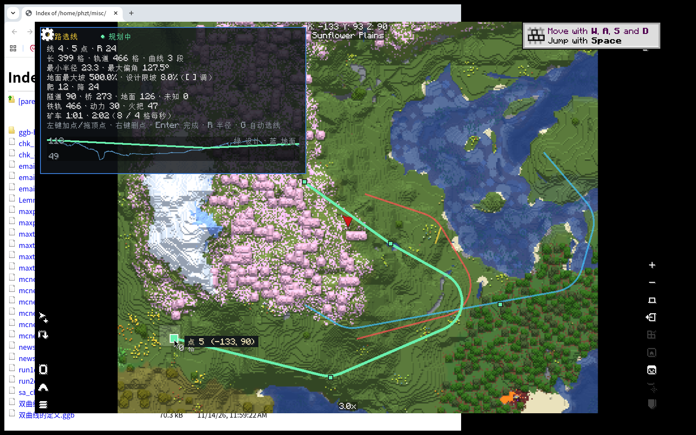
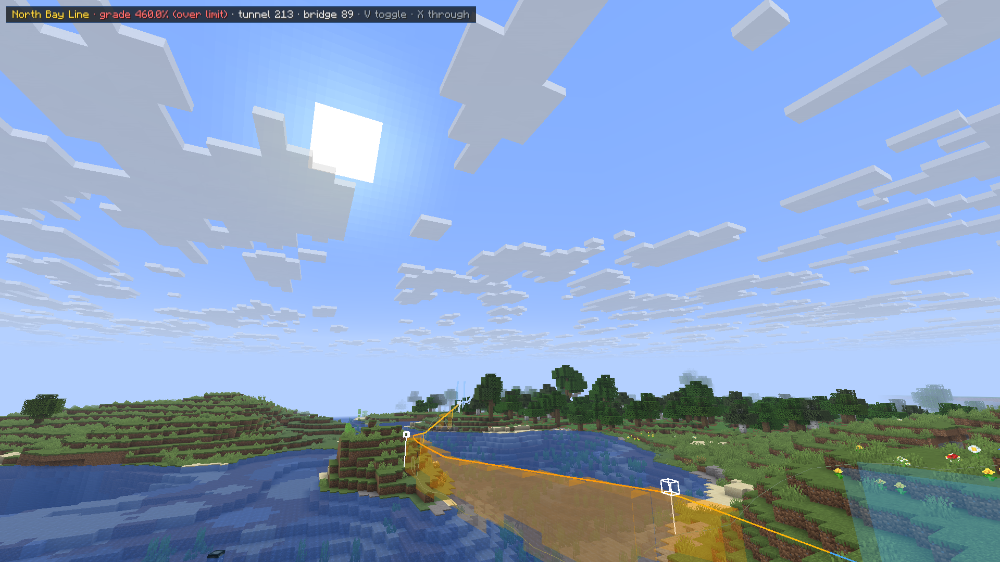
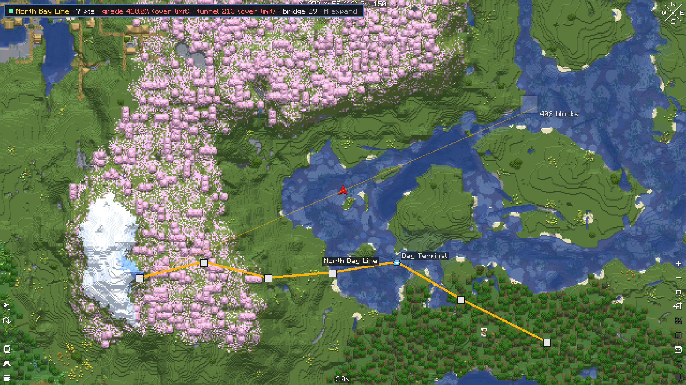

# Rail Planner — 铁路选线（Fabric 26.3）

[English](README.en.md) · 中文

挂在 **Xaero's World Map** 世界地图里的铁路选线工具：在地图上点几下把线画出来，程序按铁路工程口径把折线圆角化成「切线—圆曲线—切线」，像素化到方块得到真正能铺的轨道走行线，并统计长度、坡度、隧道/桥、材料与矿车行车时间。

画完关掉地图，线还立在**三维世界**里：设计标高一条、地形一条，隧道和桥用半透明面片围出「要挖 / 要架」的那一块，隧道蓝、桥橙——走一趟就知道哪里要挖、哪里要架。编辑时你点过的每个点也会标出来，按 `L` 锁上就不怕手一抖把它拖歪。

点过的每个点还带一个 **Y（标高）**：默认取那一列最高方块的高度，**双击顶点**就能手填一个数；填过的点会把整条线的纵断面钉在那个高度上。

从 0.6.0 起它是**双端的**：同一个 jar 装到服务端，就会在服务端按 UUID 给每个玩家存一份（互相看不到），本地也留着；两边都改过同一条线时，界面上逐条问你要留哪边。换机器、重装客户端都不丢线。更新也自作主张了——查到新版就下载、按 GitHub 给的 sha256 校验、直接替换 `mods` 里的 jar，面板上多一个「立即重启」。

- 目标版本：**Minecraft 26.3 + Fabric Loader 0.19.5**（Java 25）
- **双端**：服务端不装就是纯本地；装了之后按 UUID 分玩家在服务端存一份，本地照样保留，两边都改过时逐条问你要留哪边
- 客户端**必须装 Xaero's World Map ≥ 1.47**；服务端只需要 Fabric API，不需要 Xaero
- 不修改、不重打包 Xaero 的任何代码，只用 mixin 挂进它的地图界面
- 当前版本 **0.7.1**



## 装

**客户端**：Fabric 26.3 + **Fabric API** + **Xaero's World Map ≥ 1.47**，把 `railplanner-0.7.1.jar` 丢进 `mods/`；Mod Menu 可选（不装也能用，按 `U` 开设置页）。

**服务端（可选）**：同一个 jar 丢进服务端的 `mods/`，不用改任何配置。服务端只认 Fabric API——**不需要 Xaero，也不需要任何客户端模组**。没装也照样能进服，只是数据只留在本地。

## 用

进世界按 `B` 打开地图并进入规划模式，左键点几下就有线了，`Enter` 存盘。

| 默认键 | 作用 |
|---|---|
| `B` | 开地图进规划 / 地图里规划↔只读切换 |
| 左键 / 右键 | 加点、拖顶点 / 删点 |
| 双击顶点 | 改这个点的 Y（标高），数字输入、回车确认、Esc 取消 |
| `Enter` · `Delete` | 完成存盘 · 撤销最后一个点 |
| `R` · `Shift+R` | 圆曲线半径 ×1.25 · ×0.8（4–200 格） |
| `[` `]` | 设计限坡 ∓1%（`Shift` 一次 5%），1–30% |
| `J` | 从最后一个点到鼠标自动选线 |
| `H` | 面板折叠成一行 / 展开（状态会记住） |
| `U` | 设置页（更新检查、按键入口） |
| `V` | 世界里的 3D 线开 / 关 |
| `X` | 3D 线穿山可见（画在所有东西之上） |
| `L` | 锁住已选的点，防止误拖 |

十二个键全部可在 **选项 → 控制 → 按键绑定 → 铁路选线** 里改，改完提示字跟着变。

设置页里还有一个 **「停用全部快捷键」** 开关：打开之后本模组的按键和鼠标操作一起停（免得和别的模组抢键），只剩「打开设置页」那个键还活着——不然就没法再开回来。状态写进配置，重启也保持。

关掉地图，线就在世界里立着（`V` 关掉、`X` 穿山看）：



折叠后的面板长这样，坡超限、隧桥占比过高的项会标红：



## 文档

- **[使用手册（详细）](docs/使用手册.md)** —— 面板每一行什么意思、半径和限坡到底改了什么、世界里的 3D 线怎么看、配置文件字段、常见问题、一次完整示范
- [世界里的 3D 线](docs/使用手册.md#14-世界里的-3d-线) —— 四样东西、显示条件、`V` / `X` / `L`、开销
- [设置页与自动检查更新](docs/使用手册.md#7-设置页自动检查更新与自动安装) —— 两栏十个按钮、状态行怎么读
- [双端同步](docs/使用手册.md#15-双端同步服务端那份) —— 服务端装不装的区别、按 UUID 隔离、同 IP 不同端口算同一台服务器、冲突怎么选
- [自动更新](docs/使用手册.md#16-自动更新热更新到底能到哪一步) —— 下载、sha256 校验、就地替换、自重启
- [采样点的 Y](docs/使用手册.md#63-采样点的-y默认取最高方块) —— 双击改标高、纵断面怎么被钉住、办不到的坡什么样
- [服务端自动更新](docs/使用手册.md#17-服务端自动更新mcdr-插件) —— MCDR 插件：换 jar、按开关重启
- [已知限制](docs/使用手册.md#12-已知限制)

## 构建

```sh
./tools/fetch-xaero.sh     # 下载编译用的 Xaero 26.3 jar（不进仓库：Xaero 是 All Rights Reserved）
./tools/fetch-modmenu.sh   # 下载编译用的 Mod Menu（可选依赖，同样不进仓库）
./gradlew25 build          # 不要用 ./gradlew：全局 ~/.gradle/gradle.properties 把 JVM 钉在 java-21
```

产物：`build/libs/railplanner-0.7.1.jar`。

自检：`./tools/geom-check.sh`（圆曲线参数与像素化连续性）、`./tools/vertical-check.sh`（点钉住、限坡、直线兜底）、`./tools/version-check.sh`（版本号比较），都不启游戏。

服务端自动更新插件（MCDR）在 `server-plugin/`，装法见[使用手册 §17](docs/使用手册.md#17-服务端自动更新mcdr-插件)。
开发调试：`./gradlew25 runClientTest` 直接进 `run/saves/railplanner_test`（1440×900），方便在无头 X 里截图。

## 已知限制（三条最要紧的）

- 只读 Xaero **已探索**的区域，没走过的地方记「未知」
- 对着 Xaero **1.47.2** 写的，Xaero 升级后内部类名变了要跟着改 mixin
- 只有单一半径圆曲线（没有缓和曲线），纵断面按「点钉住 + 两点之间限坡」推（没有竖曲线）
- 相邻两点的高差如果超出「限坡 × 距离」，这一段就按直线走、设计坡标红——那是办不到的坡，得挪点或改 Y

完整清单见[使用手册 §12](docs/使用手册.md#12-已知限制)。

## 许可

MIT，见 [LICENSE](LICENSE)。
