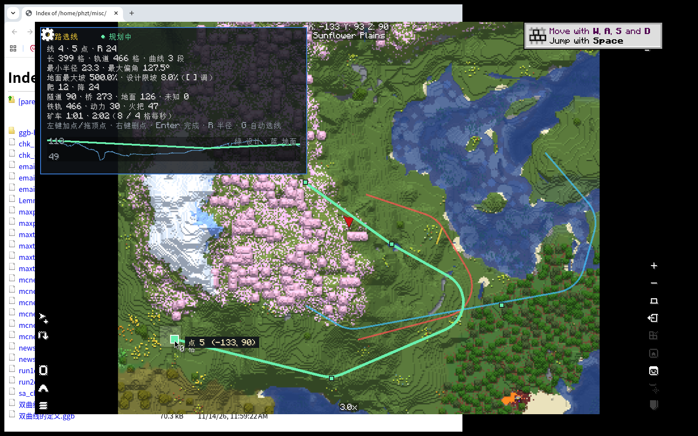

# Rail Planner

**Pick points on your world map. Get a railway.**

Rail Planner lives inside Xaero's World Map. Click a handful of points and it fits a real alignment through them — tangent, circular curve, tangent — then snaps that curve onto blocks, so what you see is what you can lay. Along the way it answers the questions a railway builder actually has: how long is it, how steep does it get, how much of it is tunnel or bridge, how many rails and powered rails to buy, and how long a cart takes to run it.

When you close the map the line does not vanish. It stands in the 3D world next to your rails — design level, terrain, and the pillars between them — showing exactly what to dig out and what to build up.

## ⚠️ Up front: this is not a survival mod

It serves exactly one purpose — building a railway in Minecraft that would survive a real-world engineering review: design grade, curve radius, tunnel depth, bridges, the vertical profile. If you're playing survival and just want a minecart to carry you from A to B, **you don't need it, and it isn't recommended.**

It will not get your minecart there faster, and it will not save you a single block of digging. What it will do is make you spend an afternoon arguing with yourself about whether 12‰ is too steep, then drag the whole line back and redraw it; make you work out that a full run takes 4 minutes and then redraw a third of the route to shave 20 seconds; make you press `R` on the same line until you forget what you were adjusting.

Your time is yours to waste. But this thing can genuinely turn a weekend into a longitudinal profile — decide before you install.

## What it actually does

**Alignment geometry, not a polyline.** Every corner is filleted into tangent–arc–tangent with one shared radius (default 24 blocks, adjustable 4–200). `R` scales it by 1.25, `Shift+R` by 0.8. Where two points sit too close for the arc to fit, the radius is quietly reduced, and the panel reports the smallest radius you actually ended up with — so you never look at a curve the geometry had to cheat on.

**A vertical profile pinned to your points.** Every point carries X / Z / Y: Y defaults to the top block of its column, and X / Z can be typed in by hand to drop the point on an exact column. Double-click a vertex to edit all three. Between points the profile runs at your design gradient (default 8%, 1–30%, set with `[` and `]`), and stays pinned to the Y values you chose. If two points are too far apart in height for your gradient, that span is drawn straight and the grade turns red — the program telling you to move a point or change a Y, not a bug.

**A line you can walk along.** `V` shows the design line, the ground line and the fill/cut pillars in the world; `X` shows them through terrain. Tunnels are blue, bridges orange, so a glance answers “dig here or build up here”. Default range 256 blocks.

**Numbers with a definition.** Real arc length versus block length (the second one is what you buy), curve segments, minimum radius, maximum deflection, ground max grade (terrain smoothed over a 5-block window so trees don't count), design max grade, total climb and descent, tunnel / bridge / ground / unknown mileage, rails, powered rails (1 per 16), torches (1 per 10), and cart travel time at 8 and 4 blocks per second.

**Points with identity.** Double-click a vertex for five fields: X, Z, Y, name, and type — plain, station, curve control point, tunnel portal, bridge, signal. Each type gets its own glyph, on the map and in the world. Double-click the route name on the panel to rename the line and recolour it: 12-swatch palette, hue bar, or raw RGB.

**Edit a point in the world, too.** With the trigger item in hand (rails by default) and the crosshair on a point's vertical pin, a right-click opens the very same five-field box — no need to open the map just to fix one elevation. The item and an on/off switch live in the left column of the settings page.

**Lock one point, not all of them.** With a chain in your main hand (the item is configurable, default \`minecraft:iron_chain\`), right-click a point's pin and it flips that one point's lock: locked, it refuses to be dragged while every other point still moves. The lock is stored with the point, travels through the server sync, and the point is dimmed on the map and in the world so you can see it at a glance. \`L\` still locks every point at once, and turning the world-item switch off leaves the chain working — otherwise a locked point could never be unlocked again.

**Insert without reshaping.** Hold Ctrl and click on the line to insert a point between two existing ones. It snaps onto the curve, so the alignment stays exactly where it was.

**Optional server sync.** Drop the same jar into the server's `mods/` folder and every player's lines are stored server-side, per UUID, invisible to each other. Your local copy stays. When both sides changed the same line, the UI asks line by line which copy to keep. Reinstalling the client or switching machines no longer loses your plans.

**Updates without the manual download.** The mod checks the GitHub releases API (with an ETag, so an unchanged check costs nothing against the unauthenticated rate limit), downloads a new jar when there is one, verifies the sha256 published with the release, and swaps it in place. Fabric cannot hot-swap classes, so you still restart once — the mod shows a “Restart now” button when it is ready.

## Screenshots

The gallery walks through the whole loop: picking points on the map with the panel recalculating, the route name editor, the point Y / name / type box, the finished line standing in the 3D world, the same line seen through terrain with `X`, the collapsed one-line panel, and the settings page.

## Requirements

- **Client:** Minecraft 26.3, Fabric Loader 0.19.5+, Java 25, Fabric API, and **Xaero's World Map 1.47.x**
- **Server (optional):** the same jar, plus Fabric API. No Xaero, no client-side mod required on the server.
- **Mod Menu** is optional: without it, press `U` for the settings page.

## Install

1. Install Fabric Loader for Minecraft 26.3 and put Fabric API in `mods/`.
2. Put Xaero's World Map 1.47.x in `mods/`.
3. Put `railplanner-0.9.0.jar` in `mods/`.
4. Start the game, enter a world, press `B`.

For a server, copy the same jar into the server's `mods/` and restart. Nothing to configure. Players without Rail Planner can still join; only the sync stops being available to them.

## Default keybinds

- `B` — open the map in planning mode; toggle planning / read-only
- Left click — add a point; drag a vertex
- Right click — delete a point
- Ctrl + left click on the line — insert a point
- Double-click a vertex — edit X, Z, Y, name, type
- Main hand on a chain + right-click a point — lock / unlock just that point
- Hold the trigger item (rails) + right-click a point — edit that point in the world
- Double-click the route name — rename, recolour
- `Enter` — finish and save
- `Delete` — undo the last point
- `R` / `Shift+R` — radius ×1.25 / ×0.8
- `[` / `]` — design gradient ∓1% (`Shift`: 5%)
- `J` — auto-route from the last point to the cursor
- `H` — collapse the panel to one line
- `U` — settings page
- `V` — 3D line on / off
- `X` — 3D line visible through terrain
- `L` — lock the selected points against accidental dragging

All of them are remappable in Options → Controls → Key Binds → Rail Planner, and the on-screen hints follow your changes. There is also a “Disable all hotkeys” switch on the settings page, for when another mod wants the same keys — it keeps the settings key alive so you can turn it back on.

## How the numbers are counted

- **Tunnel**: ground 4 or more blocks above the design level. **Bridge**: ground 4 or more blocks below it. Within ±4 blocks it counts as ground you can lay straight on — two blocks up is a slope, not a tunnel.
- **Red flags**: ground max grade above your design gradient + 0.05%; tunnel or bridge above 35% of the classified mileage *and* above 32 blocks; unknown cells turn orange.
- **Auto-route** (`J`) is an A* search on an 8-block grid: steeper is more expensive, water costs extra, and it gives up when the bounding box would exceed roughly 240,000 cells (about 3,450 blocks square) — split the run in two instead.
- **Materials** are estimates: rails = track length, powered rails = `ceil(length / 16)`, torches = `ceil(length / 10)`.

## Known limitations

- Only areas Xaero has already mapped. Unexplored cells are counted as **unknown**, and auto-route prices them as a guess.
- Written against Xaero's internal classes for World Map **1.47.2**; the jar is pinned to 1.47.x. A Xaero update that renames those classes needs a matching Rail Planner update.
- **Single-radius arcs only** — no easements or transition curves. The vertical profile is a gradient cut between pinned points, **no vertical curves**, so a change of gradient is a hard corner.
- One route is edited at a time; others are displayed but not editable until you pick them.
- The radius is shared by the whole line; it cannot be set per corner.
- Sync compares content: if both sides added a point to the same line, that is a conflict and you pick a side. No per-point merge.
- Server identity is per hostname, so `play.example.com` and its bare IP are two different datasets. Pick the domain early.
- Auto-update needs to reach github.com. If it cannot, the settings page shows why and drawing keeps working.
- New versions need one restart. Fabric's class loader and mixins cannot be swapped under a running game; the mod automates the download, the check and the replace, not the restart.

## Links

- Source, issues, full manual: [github.com/phzt-hub/railplanner](https://github.com/phzt-hub/railplanner)
- Detailed manual (English): [docs/manual.en.md](https://github.com/phzt-hub/railplanner/blob/master/docs/manual.en.md)
- Licence: MIT

---

# 中文

**在地图上点几下，得到一条铁路。**

Rail Planner 挂在 Xaero's World Map 里。你点几个点，它把这些点拟合成一条真正的线形——切线、圆曲线、切线——再像素化到方块上，看到的线就是能铺出来的轨道。顺手把修铁路要问的数全算了：多长、多陡、多少隧道多少桥、要买多少铁轨和动力铁轨、矿车跑一趟要多久。

关掉地图它也不会消失。线立在三维世界里：设计标高、地面标高，中间是填挖立柱，哪段要挖、哪段要架高，一眼看明白。

## ⚠️ 先说清楚：这不是生存模组

它只服务一个目的——在 Minecraft 里修一条经得起现实物理推敲的铁路：限坡、圆曲线半径、隧道埋深、桥、纵断面。如果你玩的是生存、只想让矿车把你从 A 送到 B，**用不到它，也不推荐用**。

它不会让你的矿车更快，也不会帮你少挖一块石头。它只会让你在某个下午开始计较「这段 12‰ 是不是太陡」，然后把刚画好的线整个拖掉重来；让你算完矿车跑完全程只要 4 分钟，再为了省 20 秒把三分之一的线重画一遍；让你在同一条线上反复按 `R`，直到忘了自己在调什么。

时间是你的，浪费在哪儿也是你的自由。但这东西确实能把一个周末变成一张纵断面图——想清楚了再装。

## 它到底做了什么

**是线形，不是折线。** 每个拐角都圆角化成切线—圆曲线—切线，全条线共用一个半径（默认 24 格，可调 4–200 格）。`R` 放大 1.25 倍，`Shift+R` 缩到 0.8 倍。相邻点太近、圆弧塞不下时程序会自动把半径压下来，面板显示你实际得到的最小半径——不会让你对着一条偷偷改过的曲线铺轨。

**纵断面钉在你点的点上。** 每个点带 X / Z / Y：Y 默认取那一列最高方块，X / Z 可以手输，把点放到准确的那一列上；双击顶点三样一起改。两点之间按你设的设计限坡走（默认 8%，1–30%，`[` `]` 调），整条纵断面始终钉在你给的 Y 上。如果两点的高差超出这个限坡办得到的范围，这一段就按直线走、坡度标红——那是程序在说「挪点或者改 Y」，不是算错了。

**一条能在世界里走一遍的线。** `V` 在世界里画出设计线、地面线和填挖立柱，`X` 让它们穿透地形显示。隧道蓝、桥橙，抬眼就知道这段是该挖还是该架。默认显示范围 256 格。

**每个数都有口径。** 曲线真实弧长与方块串长度分开算（后者才是你要买多少），圆曲线段数、最小半径、最大偏角、地面最大坡（地形先做 5 格窗口平滑，树不算）、设计最大坡、总爬升与总下降、隧道/桥/地面/未知的里程、铁轨、动力铁轨（每 16 格 1 个）、火把（每 10 格 1 个）、按 8 格/秒与 4 格/秒各算一次的矿车时间。

**点有身份。** 双击顶点五行框：X、Z、Y、名字、类型（普通点、车站、弯道控制点、隧道口、桥梁、信号机），每种类型在地图上和世界里各画一种形状。双击面板上那行线名，可以改线名和颜色：12 色色板、色相条、或者直接填 RGB。

**点也能在世界里直接改。** 主手拿触发物品（默认铁轨），准星对准点位那根竖针右键，弹出的还是那个五行框——为了改一个标高不用再开地图。物品和开关都在设置页左栏。

**只锁一个点，不是锁全部。** 主手拿锁链（物品可换，默认 \`minecraft:iron_chain\`），右键点位那根竖针，就把**这一个点**的锁翻过来：锁上就拖不动它，别的点照常拖。锁存在点上、跟着同步走，地图和世界里这个点都压暗一档，一眼看得出。\`L\` 仍然是「全锁」，而把「拿物品右键改点」关掉之后锁链那半照样能用——否则锁住的点就再也解不开了。

**插点不破坏线形。** 按住 Ctrl 点那条线，新点插进光标所在的那一段，位置吸附到线上，线形一格都不会变。

**服务端同步是可选的。** 同一个 jar 装进服务端的 `mods/`，每个玩家的线按 UUID 存在服务端，互相看不到，本地也照样留一份。两边都改过同一条线时，界面逐条问你要留哪边。换机器、重装客户端都不丢。

**更新不用来回折腾启动器。** 查 GitHub releases API（带 ETag，304 不占未登录额度），有新版本就下载、按 release 里给的 sha256 校验、就地替换。Fabric 没法在运行中换类，所以还是要重启一次——下载、校验、替换它都替你做完了，只留一个「立即重启」按钮。

## 安装

**客户端**：Minecraft 26.3 + Fabric Loader 0.19.5+ + Java 25，`mods/` 里放 Fabric API、Xaero's World Map 1.47.x 和 `railplanner-0.9.0.jar`，进世界按 `B`。Mod Menu 可选，不装就按 `U` 开设置页。

**服务端（可选）**：同一个 jar 丢进服务端 `mods/`，不用改配置。服务端只要 Fabric API，不需要 Xaero，也不需要客户端模组；没装的玩家照样能进服，只是没有同步。

## 默认按键

`B` 开图规划 / 规划↔只读 · 左键加点、拖顶点 · 右键删点 · Ctrl+左键点在线上插点 · 双击顶点改 X/Z/Y/名字/类型 · 双击线名改名改色 · 拿物品右键点位改点 · 拿锁链右键点位只锁这一点 · `Enter` 完成存盘 · `Delete` 撤销 · `R` / `Shift+R` 半径 ×1.25 / ×0.8 · `[` `]` 限坡 ∓1%（`Shift` 5%）· `J` 自动选线 · `H` 折叠面板 · `U` 设置页 · `V` 3D 线开关 · `X` 穿山 · `L` 锁点。全部可在 选项 → 控制 → 按键绑定 → 铁路选线 里改。

## 已知限制

- 只读 Xaero **已探索**的区域，没走过的地方记「未知」。
- 对着 Xaero **1.47.2** 的内部类写的，jar 锁在 1.47.x；Xaero 改了那些类名就得跟着更新。
- **只有单一半径圆曲线**，没有缓和曲线；纵断面只做限坡剖切，**没有竖曲线**，换坡就是硬折角。
- 一次只编辑一条线；别的线只显示，点它才切过去。
- 半径整条线共用，不能单拐角调。
- 同步只比内容：两边各加一个点算冲突，得自己选一边，不做逐点合并。
- 服务端身份只认主机名，`play.example.com` 和它的 IP 是两份数据，最好一开始就用域名。
- 自动更新要能连上 GitHub；连不上就在设置页显示原因，画线不受影响。
- 新版本要重启一次才生效。

## 链接

- 源码、问题反馈、完整手册：[github.com/phzt-hub/railplanner](https://github.com/phzt-hub/railplanner)
- 中文使用手册：[docs/使用手册.md](https://github.com/phzt-hub/railplanner/blob/master/docs/使用手册.md)
- 许可：MIT
