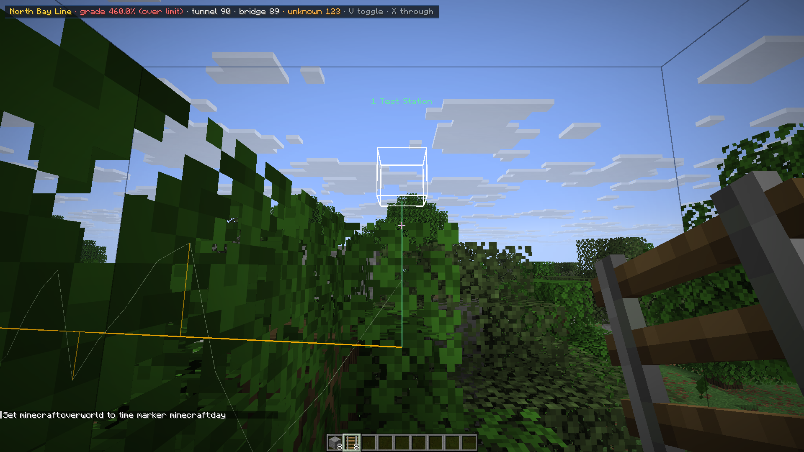

# Rail Planner · User Manual

[中文](使用手册.md) · English

This manual is not a feature list. It answers three things only: **how to use it**, **what every number on the panel means**, and **what is wrong when pressing something does nothing**.

- First time here → [§2 Five-minute start](#2-five-minute-start)
- Just want to read the panel → [§3 Reading the panel](#3-reading-the-panel-expanded)
- Want to change radius or grade → [§6 The three parameters that actually change the result](#6-the-three-parameters-that-actually-change-the-result)
- Something went wrong → [§11 FAQ](#11-faq)

---

## 1. What it is actually drawing

This is the thing people get wrong most often, so let's get it out of the way: **the points you click are not the track, they are the "centreline".**

That is how real railways are built too: fix a handful of control points on the drawing, join them into a polyline (that is the centreline), insert a circular curve at every corner, and only then put it on the ground. This mod does the first two steps:

```
What you click:  A ──────── B ──────── C        a polyline, the kind that pokes you
What it draws:   A ────╮         ╭──── C        every corner becomes a circular curve
                       ╰─────────╯
What you lay:    one block at a time along that curve
```

So:

- **Don't try to click every bend** — the denser you click, the less room there is for a circular curve (the next section explains why), and the less smooth the line gets.
- In the end the mod cuts it into an **8-connected string of blocks**, and that is the running line you can lay block by block.
- It **does not lay anything for you**, does not change the world, and does not sync over the network. The line only exists on your own client; nobody else can see it.

Technically it reads **the height data Xaero's World Map has already stored**: it doesn't load chunks, doesn't read the save file, and doesn't touch the network.

---

## 2. Five-minute start

### Install

1. Minecraft **26.3** + **Fabric Loader 0.19.5** (Java 25 runtime)
2. The client must have **Fabric API** and **Xaero's World Map ≥ 1.47**
3. Drop `railplanner-0.8.3.jar` into the client's `mods/`; Mod Menu is optional (it works without it — press `U` for settings)
4. **The server side is optional**: drop the same jar into the server's `mods/`, no config changes. With it installed, data is stored per UUID on the server and comes back automatically when you change machines; without it, it is purely local, exactly like 0.5.0. The server **does not need Xaero** and needs no client mods either

### Use

1. Enter a world and press `B` — the world map pops up and "Rail Planner ● Planning（铁路选线 ● 规划中）" appears in the top-left corner
2. **Left-click three times** on the map; three points make a line and it is rounded immediately
3. Grab the middle point and drag it, and watch the curve follow (this is the step that builds intuition)
4. When it looks right, press `Enter` — the route is saved and the next click starts a new one
5. Press `B` to leave planning mode: the line is still there, it just can't be edited any more (so you can lay track against it)
6. `Esc` closes the map; go back into the world and lay block by block


One trick while laying: zoom the map past **1.2 pixels per block** and the mod draws that block string one block at a time, so laying against it never goes off by one.

---

## 3. Reading the panel (expanded)

The panel in the top-left corner is expanded by default and has at most eight rows. Every row has a defined meaning; none of it is a rough estimate:

| Row | Example | Meaning |
|---|---|---|
| 1 | `Route 1 · 3 pts · R 24` | Current route name, anchor count, circular-curve radius (blocks) |
| 2 | `Len 412 blocks · track 402 blocks · 2 curves` | Geometric length of the smoothed curve / **how many blocks of rail you actually lay** / how many circular curves were inserted |
| 3 | `Min radius 18.4 · max deflection 47.2°` | The tightest radius of all corners, and the sharpest turn angle |
| 4 | `Terrain max grade 12.4% (over limit) · design grade 8.0% ([ ] to adjust)` | The steepest point of the terrain itself / the grade you allow the line to be built at |
| 5 | `Climb 37 · drop 12` | Total climb and total drop of the design vertical profile (blocks) |
| 6 | `Tunnel 128 · bridge 40 · ground 210 · unknown 34` | Mileage in three classes, decided by a 4-block height difference |
| 7 | `Rail 402 · powered 26 · torches 41` | Material estimate |
| 8 | `Minecart 1:23 · 2:46 (8 / 4 blocks per second)` | Travel time at full-speed powered rail and at normal speed |

Below that is a **small grade-profile chart** (42 pixels high):

- **Blue line = ground**, read from the terrain height Xaero has stored
- **Green line = design**, a vertical profile that can be built within your grade limit
- The two ends are the highest / lowest elevation along this stretch

Once you can read this chart you have the main point: **the two lines together = you can lay it on the ground here; apart = you dig (blue on top) or you bridge (blue underneath).**

Row 3 is the one most easily skipped, and it is the direct evidence of whether your line is drawn well: too small a minimum radius, too sharp a deflection — the corners are simply harsh.

Hover over a vertex (within 7 pixels) to see its block coordinates; hover near a corner (within 22 pixels) to see that bend's `R / Δ / T / L / E` — radius, deflection, tangent length, curve length, external distance.

---

## 4. Reading the panel (collapsed)

If it gets in the way, press `H` and it folds into one line:

```
Route 1 · 3 pts · grade 9.2% (over limit) · tun 28 · br 68 (over limit) · unknown 8 · H to expand
```


The rules are simple:

- **Grade（坡）** above your design grade → red
- **Tunnel / bridge（隧道 / 桥）** more than **35%** of the classified length **and** more than **32 blocks** → red (both conditions have to hold, so short routes don't raise false alarms)
- **Unknown（未知）** (never explored) → orange, meaning the stats for this stretch are incomplete, not that the line is hard to build
- The little square on the left: **green = planning**, grey = read-only

Folding only affects the panel; the coordinate tooltip on a vertex and the `R / Δ / T / L / E` tooltip on a bend still pop up as usual.


This state is stored in the config file: **press it once and it stays collapsed**, across game restarts and other saves. To have it collapsed by default, set `hudCollapsed` to `true` in the config (see [§8](#8-config-file-and-saves)).

With the map closed there is a shorter version of the same bar in the top-left of the world (grade, tunnel and bridge only), and the 3D line is still there — see [§14](#14-the-3d-line-in-the-world).

---

## 5. Keys

| Default key | Name | What it does | When it works |
|---|---|---|---|
| `B` | Planner mode（规划模式） | In the world: open the map in planning mode. In the map: toggle planning / read-only | Global |
| Left click on the map | — | Add an anchor (snapped to the block grid) | Planning mode |
| Left-drag a vertex | — | Move that point | Planning mode |
| Right-click a vertex | — | Delete this one point (**the only way to delete a middle point**) | Planning mode |
| Main hand on the trigger item, right-click a point | — | Edit that point's **Y / name / kind** right in the world: the same box, firing only when the crosshair is on its pin (see [§6.5](#65-editing-a-point-in-the-world)) | In the world, with the map closed |
| Left click on an existing line | — | Click within 6 pixels of a line to pick that line up and keep editing it | Planning mode |
| `Ctrl` + left-click on a line | — | **Insert** a point between two existing ones, snapped onto the nearest point of the line (shape unchanged) | Planning mode |
| Double-click a vertex | — | Change that point's **Y / name / kind**: three rows, `Tab` moves, `←` `→` cycles the kind, Enter saves, Esc cancels | Planning mode |
| Double-click the panel's name row | — | Change this line's **name and colour**: click a swatch, drag the hue bar, or type RGB | Planning mode |
| Left-drag empty space | — | Pan the map as usual | Any state |
| `Enter` | Finish route（完成这条线） | Saves; the next click starts a new route | Planning mode |
| `Delete` | Remove last point（撤销最后一个点） | Removes the last point only; middle points can't go | Planning mode |
| `R` / `Shift+R` | Curve radius（圆曲线半径） | ×1.25 / ×0.8 (4–200 blocks) | Planning mode |
| `[` `]` | Design grade（设计限坡） | ∓1% (`Shift` makes it 5% at a time), 1–30% | Planning mode |
| `J` | Auto-route（自动选线） | Finds a path from the last point to the cursor | Planning mode, with at least one point placed |
| `H` | Collapse panel（折叠面板） | Toggles one line / expanded | Planning mode |
| `U` | Settings page（设置页） | Opens settings (update check, key bind entry) | In the world, with no screen open |
| `V` | 3D line in the world（世界里的 3D 线） | Master switch for the 3D line in the world | In the world, with no screen open |
| `X` | 3D line through terrain（3D 线穿山可见） | Normal occlusion / drawn on top of everything | In the world, with no screen open |
| `L` | Lock placed points（锁住已选的点） | Once locked, left-dragging a vertex no longer moves it (prevents slips) | In the map or in the world |
| `Esc` | — | Closes the map and saves automatically | In the map |

Once locked, left-clicking a vertex only pops up "point locked, it won't move（点已锁定，拖不动）" and the point stays where it is; right-click delete and `Delete` undo are unaffected.

### Rebinding keys

**Options → Controls → Key Binds → Rail Planner（选项 → 控制 → 按键绑定 → 铁路选线）** — all twelve keys are in there, and a change takes effect immediately.

The key letters shown in the panel and in the world **read the same bindings**, so if you change `B` to `K`, the hints turn into `K` on their own, with no restart needed.

Three of the defaults were picked after running into walls:

- `G` was meant for auto-route, but vanilla's "quick actions（快捷动作）" already owns it → moved to `J`
- `O` was meant for the settings page, but vanilla's "friends list（好友列表）" already owns it → moved to `U`
- `H` really does share a key with vanilla's `debug.showAdvancedTooltips`, but that one only takes effect inside `F3`, so normally pressing it does nothing and there is no conflict

Before rebinding something yourself, check `options.txt` for a collision, so two features don't end up fighting over one key.

---

## 6. The three parameters that actually change the result

Everything else is display and toggles; **only these three actually change the shape of the line**.

### 6.1 Circular-curve radius R (default 24 blocks)

`R` grows it, `Shift+R` shrinks it, range **4–200**, geometric steps (24 → 30 → 37.5 …).

Three things you have to know:

**① It is a property of the whole route, not of a single corner.** One press changes every corner on the route. Tuning just one corner — not possible; that is how the model is designed right now.

**② The actual radius gets squeezed down by the length of the legs on either side.** Fitting a circular curve into a corner means giving up a tangent length T = R·tan(Δ/2) on each side. The mod caps that tangent at **49% of the shorter leg**, then solves the radius back out (R = T ÷ tan(Δ/2)).

That produces three effects you will certainly run into:

- **Points too close, and the radius won't grow.** Two points only 20 blocks apart allow at most 9.8 blocks of tangent; on a 90° corner the radius is squeezed to 9.8 blocks and setting 200 changes nothing.
- **The sharper the turn, the smaller the radius you get.** For the same leg length, a gentle 30° bend fits a large radius while a hard 90° corner only fits a small one — because tan(Δ/2) got bigger.
- **When the radius is squeezed below 0.5 blocks, that corner gets no circular curve at all**, and what you see is a sharp corner.

> So "I pressed `R` a dozen times and nothing happened" is not a broken key: the neighbouring points are too close or the turn is too sharp. **Drag the points apart**, or use fewer points.

**③ A small radius = it hugs the centreline you clicked and corners hard; a large radius = smooth, but it visibly cuts the inside of the corner away.** In reality a large radius is a good thing; in the game, past a certain point, you'll find the line sitting further from the terrain you clicked — because the circular curve shaved the corner off.

"Min radius（最小半径）" on row 3 is the smallest value after squeezing; it is normal for it to disagree with the `R` on row 1.

### 6.2 Design grade (default 8%)

`[` lowers it, `]` raises it, `Shift` makes each press 5%, range **1%–30%**.

**One number changes four things at once:**

| Lower the grade | Raise the grade |
|---|---|
| Flatter profile, less climbing | The profile hugs the terrain |
| Longer tunnels and bridges | Shorter tunnels and bridges |
| "Grade (over limit)" turns red more easily | The red goes away (but you only relaxed the standard) |
| Lots of earthwork | Less earthwork, but steeper |

The 8% default is not arbitrary: in Minecraft a powered rail climbs about 1 block every 12, which works out to 8%. Set it to 4% and you are demanding "this whole stretch may only climb as slowly as plain rail", so tunnels explode — that is the mod honestly reflecting your demand, not a bug.

**What it does not affect:** the horizontal shape (where the line turns), and the "terrain max grade（地面最大坡）" number — how steep the ground is and how steep you allow the line to be are two different things.

---

### 6.3 Sampling point Y (defaults to the highest block)

Every point carries a Y, which is **the design elevation where the line passes that point**.

**Default**: at the moment you click, it takes **the height of the highest block** in that column (the ground surface without leaves, the same height the panel's "terrain max grade" uses). If that area hasn't been seen by the map yet and the chunk isn't loaded, it records **64** for now, and switches to the real height once Xaero has explored the area (or the chunk has been loaded).

**How to change it**: hover a vertex and **double-click**; a box appears next to it and its first row is `Y`: digits / minus to type (fully selected on open, so the first digit replaces the old value), Backspace deletes, `Enter` saves, `Esc` cancels, clicking elsewhere on the map saves too. The same box has `名字` (name) and `类型` (kind) rows — see [6.4](#64-point-names-point-kinds-and-line-colours).


A point you edited is marked "manual"; dragging it only changes its position, not its elevation. A point you didn't edit re-samples the ground height when dragged to a new position.

**How it shapes the line**: the vertical profile has to pass through these heights.

- **The height difference between two adjacent points fits the grade** (|ΔY| ≤ grade × distance): between them the profile hugs the terrain, clamped by the range each end allows at that grade, so it never goes over the limit.
- **It does not fit the grade**: both ends are hard-pinned, so satisfying both was never possible; that stretch runs as a straight line between the two points and "design max grade（设计最大坡）" on the panel turns red — **this grade is impossible**: either pull the points apart and move one lower, or raise the grade limit (`]`), or delete one of the points.

So with the default value equal to the ground height, the line basically still walks on the ground; change one Y by hand and that stretch is pushed up / pressed down to it.

> A common sight: one point on a summit, one at the foot of the hill, very close together, and the moment you change a Y the panel goes red all over. The maths isn't wrong — the grade you asked for simply exceeds the limit. Pull the points apart, or accept tunnels/bridges.

Code: `Anchor` (each point carries y, manual, resolved), `VerticalProfile` (pure geometry, unit-tested by `tools/vertical-check.sh`).

### 6.4 Point names, point kinds and line colours

**A point's name and kind** live in the box you open by double-clicking a vertex. Three rows:

| Row | How |
|---|---|
| `Y` | digits / minus, Backspace; fully selected on open, so the first digit replaces the old value |
| `名字` (name) | just type (ASCII through key codes, CJK through your IME or `Ctrl+V` paste), up to 24 characters |
| `类型` (kind) | `←` `→` cycles the six kinds below |

`Tab` / `Shift+Tab` (or `↑` `↓`) moves between rows, `Enter` saves, `Esc` cancels, and clicking elsewhere on the map saves as well.

The kind decides how the point is drawn on the map and in the world:

| Kind | Icon | Use it for |
|---|---|---|
| Plain (普通点) | white square | just a bend in the line |
| Station (车站) | blue disc | platforms, passing loops |
| Curve control (弯道控制点) | purple diamond | a bend the line has to make, no structure |
| Tunnel portal (隧道口) | orange triangle | entering / leaving a tunnel |
| Bridge (桥梁) | teal bar | crossing a river or a valley |
| Signal (信号机) | red cross | block boundaries, meets |

An unnamed point shows as "点 N"; a named one shows its name as the first tooltip line, next to the vertex on the map (above 0.4 px/block) and on the 3D label in the world as well.

**Line name and colour**: double-click the name row in the panel ("线 4 · 6 点 · R 24") to open the line box.

| Row | How |
|---|---|
| `名字` | type it, up to 24 characters |
| `色板` (swatches) | click one of the 12 presets; `←` `→` turns the hue by 5° |
| `RGB` | `←` `→` picks the channel, digits fill 0–255 |

`Tab` cycles the rows, and the mouse can click the swatches and the hue bar directly. In collapsed mode the name on the single-line panel opens the same box.


New lines don't need you to pick a colour: they take one from the 7-colour palette in creation order, and whatever you change sticks to that line (it is saved and synced).

### 6.5 Editing a point in the world

The same box, reached a second way: **hold the trigger item (rails by default) in your main hand, put the crosshair on a point's vertical pin in the world, right-click.**

A point counts as hit when the crosshair comes within 0.8 blocks of its pin and the pin is no more than 6 blocks along your line of sight; when several points are that close, the nearest along the sight line wins. A hit first draws a **white box** around that point, so you know which one you are about to edit; miss, and it is an ordinary right-click — blocks are placed, rails are laid. With anything else in your hand this never fires at all.



Inside it is the same three rows, with buttons around them instead of key cycling:

| Row | How |
|---|---|
| `Y` | digits and Backspace; fully selected on open, so the first digit replaces the old value |
| `Name` | just type (CJK through your IME or `Ctrl+V`), up to 24 characters |
| `Type` | click to cycle to the next one (six kinds, see [§6.4](#64-point-names-point-kinds-and-line-colours)) |


`Tab` moves between `Y` and `Name`; `Enter` or "Save" writes it; "Cancel" or `Esc` leaves the data alone. Saving goes down the **same path** as the map's box (`Planner.applyAnchorEdit` + `saveNow`): the file is written and the change synced immediately, so a change made in the world can never be missing from the map.

**Three things have to be true** (miss one and the right-click is just a right-click):

| Requirement | Where |
|---|---|
| "Right-click edit（拿物品右键改点）" is on | left column of the settings page, config `poiEdit`, on by default |
| "Show points（显示已选的点）" is on | the points are not drawn at all, so there is nothing to hit |
| "Disable all hotkeys（停用全部快捷键）" is off | that switch stops every mouse action of this mod at once |

The trigger item is configurable too: type an item id into the "Item（触发物品）" field in the left column (`minecraft:rail`, `minecraft:stick`, ...); without a namespace `minecraft:` is prepended, and it is written to disk when you leave the settings page.

Some edges:

- **Only points that are drawn can be clicked**: the map closed, the 3D line on, and points on the current route — the same condition §14 uses for drawing points
- **It edits the point, it does not move it**: there is no x/z in the box, so a right-click cannot drag a point out of place
- The hit test is against the vertical **pin** (the same one §14 draws), so you aim at the pin, not at the block on the ground
- If the route is replaced by a sync from another machine between opening the box and saving (the point's x/z moved), that save is dropped — better to lose this edit than to write it onto the wrong point

---

## 7. Settings page, automatic update checks and auto-install

Press `U` (or the gear in Mod Menu) to open it:


The screen is two columns plus a bottom bar: the left column is **3D line in the world（世界里的 3D 线）**, the right column is **editing lock / sync / updates（编辑锁定 / 同步 / 更新）**.

| Left column | What it does |
|---|---|
| 3D line: on / off（3D 线：开 / 关） | Master switch for the 3D line in the world, same as pressing `V` |
| Always on top: on / off（穿山可见：开 / 关） | Draws on top of everything, same as pressing `X` |
| Tunnel/bridge: faces / posts（隧道/桥：半透明面片 / 立柱） | How tunnels and bridges are drawn: faces are side walls plus a corridor floor, posts are a vertical line every 8 blocks |
| Show points: on / off（显示已选的点：开 / 关） | While editing, draws every point as a vertical pin with a small flag and an index number |
| Range: 64 / 128 / 256 / 512 / 1024 blocks（显示距离） | Click to cycle; lines, faces and points beyond this distance are not drawn |
| Disable all hotkeys: on / off（停用全部快捷键：开 / 关） | This mod's keys and mouse actions **stop together** (so nothing fights another mod over a key). While it is off, only the "Open settings page（打开设置页）" key still works — otherwise you could never switch it back. The state is written to the config and survives a restart |
| Sync to server: on / off（同步到服务端：开 / 关） | Off means local only, **not a single sync request is sent**; with the server mod not installed this row is just a wish (see §15) |
| Right-click edit: on / off（拿物品右键改点：开 / 关） | Hold the item below, aim at a point in the world and right-click to open the same edit box (see [§6.5](#65-editing-a-point-in-the-world)); on by default |
| Item: `minecraft:rail`（触发物品） | The trigger item's id; without a namespace `minecraft:` is prepended. Written to disk when you leave this page |

| Right column | What it does |
|---|---|
| Lock points: on / off（锁住已选的点：开 / 关） | Once locked, left-dragging a vertex no longer moves it, same as pressing `L` |
| Update check: on / off（自动检查更新：开 / 关） | **Turn it off and not a single network request is sent** |
| Check every: 6 / 12 / 24 / 48 h（检查间隔） | Click to cycle, default 12 |
| Check now（立即检查更新） | Ignores the switch and the interval, checks right away |
| Auto-download updates: off / on（自动下载更新：关 / 开） | **Off by default.** "Download and install（下载并安装）" is the manual click; turn this on and a new version is downloaded, verified and swapped into `mods` for you (see §16) |
| Download and install vX.Y.Z（下载并安装） | The manual click when auto-download is off; shows "(up to date)（已是最新）" when there is nothing newer |
| Quit game（退出游戏） | A plain quit (the world is saved). Once a new version is installed the label becomes "Quit game to apply the new version（退出游戏以应用新版本）"; you restart from the launcher |

Three buttons in the bottom bar: **Key binds…（按键绑定…） ｜ Open download page（打开下载页） ｜ Done（完成）**.

Below the buttons there are up to five status lines:

`@
Local 0.6.0　remote v0.6.0
Last checked: 2026-11-15 18:25
up to date
Sync: synced (mp_localhost)
Update: not downloaded
`@

| Line | How to read it |
|---|---|
| Local / remote（本机 / 线上） | Local is the version inside the jar, remote is the latest release on GitHub |
| Last checked（上次检查） | Setting `lastCheckEpochMs` to 0 in the config means "never checked", and the next world join checks immediately |
| Status（状态） | **Green = up to date / yellow = a newer version exists / red = the check failed (the reason follows) / grey = checking** |
| Sync（同步） | Not connected / syncing… / synced / server mod not installed, local only / conflicts to resolve / sync is off (the brackets hold this world's identity for sync) |
| Update（更新） | Not downloaded / downloading / installed, restart pending / update failed (the reason follows) |

### When the check runs

One check after entering a world, then every 5 minutes it looks to see whether the interval has expired. When it finds a new version it prints one line in chat, and **clicking that line opens the download page directly**; each version is announced once, it doesn't nag every day.

There is exactly one request, `GET https://api.github.com/repos/phzt-hub/railplanner/releases/latest`, sent with `If-None-Match`: if the version hasn't changed GitHub answers 304, and that **does not count** against the 60-per-hour limit for unauthenticated calls. Apart from `User-Agent: RailPlanner/<版本>` it sends no local data.

---

## 8. Config file and saves

### 8.1 Config: config/railplanner.json

```json
{
  "checkUpdates": true,
  "intervalHours": 12,
  "lastCheckEpochMs": 1763200000000,
  "lastEtag": "W/\"abc123\"",
  "latestVersion": "v0.3.0",
  "latestUrl": "https://github.com/phzt-hub/railplanner/releases/tag/v0.3.0",
  "hudCollapsed": false,
  "worldLines": true,
  "worldXray": false,
  "worldRange": 256.0,
  "worldSurfaces": true,
  "worldAnchors": true,
  "anchorLock": false,
  "poiEdit": true,
  "poiEditItem": "minecraft:rail",
  "hotkeysOff": false,
  "syncEnabled": true,
  "noModNotified": [],
  "autoUpdate": false,
  "pendingAssetUrl": "",
  "pendingSha256": "",
  "pendingSize": 0
}
```

| Field | Type | Hand-editable | Notes |
|---|---|---|---|
| `checkUpdates` | boolean | ✅ | Master switch for automatic update checks |
| `intervalHours` | integer | ✅ | Check interval, clamped to 1–720; the settings page only offers 6/12/24/48, hand-editing can use other values |
| `hudCollapsed` | boolean | ✅ | `true` = the panel starts collapsed into one line |
| `worldLines` | boolean | ✅ | Master switch for the 3D line in the world, same as pressing `V`; on by default |
| `worldXray` | boolean | ✅ | 3D line visible through terrain, same as pressing `X`; off by default |
| `worldRange` | float | ✅ | The 3D line only draws segments within this distance of the camera (blocks), clamped to 32–2048, default 256 |
| `worldSurfaces` | boolean | ✅ | Draw tunnels/bridges as translucent faces (`true`, default) or as posts (`false`) |
| `worldAnchors` | boolean | ✅ | Draw the placed points in the world while editing; on by default |
| `anchorLock` | boolean | ✅ | Lock the placed points, same as pressing `L`; off by default |
| `poiEdit` | boolean | ✅ | Master switch for editing a point with a right-click while holding the trigger item; on by default |
| `poiEditItem` | string | ✅ | The trigger item's id; empty means `minecraft:rail`, and a missing namespace gets `minecraft:` prepended |
| `hotkeysOff` | boolean | ✅ | Disable all of this mod's hotkeys and mouse actions (conflict avoidance); this is what that switch on the settings page writes |
| `syncEnabled` | boolean | ✅ | Master switch for server sync; `false` = local only, not a single sync request is sent |
| `noModNotified` | string array | ✅ | World identities already told "the server mod is not installed"; delete an entry and that server is told once more |
| `autoUpdate` | boolean | ✅ | On a new version: download, verify, replace the jar in `mods`; **`false` by default**, and this is what that switch on the settings page writes |
| `pendingAssetUrl` / `pendingSha256` / `pendingSize` | string / long | ❌ | URL, sha256 and byte size of the remote jar, written automatically after every check |
| `lastCheckEpochMs` | long | ⚠️ | Timestamp of the last check; 0 means "never checked" (and triggers a check at once) |
| `lastEtag` | string | ❌ | HTTP cache tag; editing it by hand costs one extra request next time |
| `latestVersion` / `latestUrl` | string | ❌ | The result of the last check; "Open download page" uses it |

Deleting the whole file = everything back to defaults. Close the game before editing by hand, otherwise the values in memory overwrite your edits on exit.

### 8.2 Saves: railplanner/<world identity>.json

One file per world. Since 0.6.0 the **world identity** is computed by the mod itself instead of using Xaero's save identifier:

| Case | Identity | Example |
|---|---|---|
| Singleplayer / LAN | `sp_<save folder name>` | `sp_railplanner_test` |
| Multiplayer | `mp_<hostname>`, **without the port** | `mp_play.example.com` |

The same server on a different port counts as **the same** world (one shared copy of the data); different hostnames are two worlds even if they point at the same machine. Illegal characters become underscores, 64 characters maximum.

**Old saves are migrated automatically**: 0.5.0 and earlier used Xaero's world id (singleplayer looked like `railplanner^us^test`, multiplayer like `Multiplayer_xxx`). The first time 0.6.x enters that world, the mod merges the routes from the old file into the new one and logs one line "migrating old save → …: N routes"; the old file is left exactly as it is, as a backup.

`@json
{
  "version": 3,
  "world": "sp_railplanner_test",
  "routes": [
    {
      "id": "0f8c1e2a-...",
      "name": "线 1",
      "color": -52429,
      "radius": 24.0,
      "anchors": [[120, -340, 71, 2], [168, -332, 258, 2], [210, -300, 68, 0]],
      "anchorNames": ["", "东站", ""]
    }
  ]
}
`@

| Field | Notes |
|---|---|
| `radius` | Circular-curve radius of this route; 0 or a missing key falls back to 24 |
| `anchors` | Anchors as `[x, z, y, flags]`: `y` is that point's elevation; bit0 of the flags = set by hand, bit1 = a real ground height has been sampled (since 0.7.0), bit8 and up = the point's kind (since 0.8.0: 0 plain / 1 station / 2 curve control / 3 tunnel portal / 4 bridge / 5 signal). Old saves only have `[x, z]`; they load as "not resolved yet" and get their real height as soon as the map opens |
| `anchorNames` | Point names indexed like `anchors` (since 0.8.0); an empty string means unnamed. Older files have no such column |
| `color` | Line colour (ARGB); new lines take one from the 7-colour palette in creation order, and double-clicking the panel's name row changes it |
| `name` | Display name |

**When it writes to disk:** at most 5 seconds after a change; finishing with `Enter`, releasing a drag and closing the map (`Esc`) all write immediately. Routes installed by server sync take the same write path.

Deleting the file = wiping every route in that world. You can also copy the file to someone else: drop it into their `railplanner/` and they see the same routes (heights are computed from their terrain).

### 8.3 Sync baseline and the server-side save

**Baseline**: `railplanner/sync/<world identity>.json`, recording "the content fingerprint of every route at the last successful sync" plus a settings fingerprint.

`@json
{
  "version": "1",
  "worldKey": "mp_localhost",
  "settings": "e23a4c95...",
  "routes": {
    "0f8c1e2a-...": "9fb76f97...",
    "3a71c0d4-...": "c1a7e2b0..."
  }
}
`@

It **plays no part in rendering**; it only decides "which side changed". Delete it and this machine counts as syncing for the first time (next time it merges both sides' routes, and asks which side to keep when the same route differs).

**Server-side save**: one file per player, bucketed by world inside.

`@
config/railplanner/players/<UUID>.json       # dedicated server
<save>/railplanner/players/<UUID>.json       # singleplayer / LAN, travels with the save
`@

`@json
{
  "version": 1,
  "uuid": "6752491e-...",
  "updatedAt": 1794737689575,
  "settings": { "worldLines": true, "worldXray": false, "worldRange": 256.0,
                "worldSurfaces": true, "worldAnchors": true },
  "worlds": {
    "mp_localhost": {
      "routes": [ { "id": "...", "name": "线 1", "color": -52429, "radius": 24.0,
                    "anchors": [[0, 0], [40, 30]], "updatedAt": 1794737600000 } ],
      "deleted": { "another-id": 1794737500000 },
      "revision": 4
    }
  }
}
`@

| Field | Notes |
|---|---|
| `worlds` | Buckets keyed by world identity; a bucket holds every route in that world |
| `deleted` | **Tombstones**: when this route was deleted, kept for 30 days. Without them, another machine that never deleted it would treat it as "mine alone" and push it back up at the next sync, and the deleted route comes back to life |
| `revision` | +1 on every write, purely for humans reading and debugging |
| `settings` | World display settings (one global copy, not per world), see §15 |

---

## 9. What the numbers mean exactly

You don't have to memorise these, but once you understand them you won't think the panel is lying to you.

| Number | Where it comes from |
|---|---|
| Length（长） | The true length of the smoothed curve (arcs included), not the polyline length |
| Track（轨道） | Length of the block string after rasterising — **this is how many blocks of rail you lay** |
| Curves, N segments（曲线 N 段） | How many circular curves were inserted, i.e. "how many corners were successfully rounded" |
| Min radius（最小半径） | The smallest of all corners after squeezing; may be far below the `R` you set |
| Max deflection（最大偏角） | The sharpest turn angle; around 45° is normal, close to 90° is a hard corner |
| Terrain max grade（地面最大坡） | The terrain height is first smoothed with a 5-block window (to erase single-block spikes like trees and posts), then the largest difference between adjacent blocks is taken |
| Design max grade（设计最大坡） | The largest difference between adjacent blocks on the vertical profile (after the points pin it); above the design grade it turns red, see [§6.3](#63-sampling-point-y-defaults-to-the-highest-block) |
| Design grade（设计限坡） | What you set yourself, see [§6.2](#62-design-grade-default-8) |
| Climb / drop（爬 / 降） | Total rise and total fall on the design vertical profile |
| Tunnel（隧道） | Mileage where the ground is **more than 4 blocks** above the design elevation |
| Bridge（桥） | Mileage where the ground is **more than 4 blocks** below the design elevation |
| Ground（地面） | Height difference within ±4 blocks: lay it straight down |
| Unknown（未知） | Xaero has no height recorded for that block (not explored) |
| Rail（铁轨） | = number of blocks |
| Powered rail（动力铁轨） | 1 per 16 blocks (`ceil`) |
| Torches（火把） | 1 per 10 blocks (`ceil`); you can use fewer depending on how you actually lay it |
| Minecart time（矿车时间） | Computed twice: at 8 blocks/s (full-speed powered rail) and at 4 blocks/s |

**Why is the tunnel/bridge threshold 4 blocks?** A difference of 1–2 blocks is neither a bridge nor a tunnel in Minecraft — a ramp connects it. Past 4 blocks you either bore a hole or build posts, and the nature of the work changes. The threshold is an empirical number, hard-coded in `RouteStats.java` and not exposed in the UI.

**The three red-flag rules** (also hard-coded; changing them means touching `PlannerRenderer.java`):

1. Terrain max grade > design grade + 0.05% → "grade (over limit)"
2. Tunnel or bridge > 35% of the classified length, **and** > 32 blocks → "(over limit)"
3. Unknown > 0 → orange text

Why rule 2 needs both conditions: on a short route a 20-block bridge is half of it, but that is not heavy engineering; only past 32 blocks is it worth rethinking the alignment.

---

## 10. A complete walkthrough

Scenario: you want a railway from a village north of the hills to a harbour to the south, with a ridge and a river in between. Assume the map is fully explored.

**Step 1: three rough points, to see whether the terrain agrees at all**

Press `B` for the map and click once at the village, once on the ridge, once at the harbour. Don't rush to fill it in — just three points. The panel is already computing, so look at two rows first:

- If "terrain max grade（地面最大坡）" is 20% or more, you will be digging through that hill however hard you try
- If the blue and green lines on the grade chart are far apart, get ready to bore a tunnel

**Step 2: let `J` try a path**

Put the cursor over the harbour and press `J`. The mod runs A* on an 8-block grid, charging more for steeper grades and extra for crossing water, and hands back a polyline simplified into a few corners.

Not happy with it? Press `Delete` a few times to undo the auto-added points one by one (it **appends** a string of corners after your last point; the start is still the original one), then add points by hand. `J` doesn't "decide for you", it "gives you a draft you can change".

**Step 3: adjust `R` and the grade, and watch the price**

Press `R` a few times to grow the radius. Watch two things change together: "min radius（最小半径）" on row 3 climbs, and at the same time the line starts shaving the inside of the corners — if you are routing around a ridge, that shaved piece may cut into the hillside, and at that point you should back off and move the point outward rather than keep growing the radius.

Then the grade: `[` down to 5% and the tunnel immediately gets longer. Ask yourself one question, **"will this line ever run fully loaded minecarts?"** — if yes, accept the tunnel; if no, `]` up to 10% and let it hug the hill, which is the better deal.

**Step 4: finalise**

`Enter` saves. Press `B` for read-only, zoom past 1.2 pixels per block to see the squares, and go lay it in the world.

Before you start, copy row 7 down: the rail, powered rail and torch counts are your shopping list.

**Step 5: go outside and check it in 3D**

Press `Esc` to close the map (planning mode is still on) and walk over to the line — it is standing in the world, with the grade/tunnel/bridge bar in the top-left. If you can't tell which stretch needs digging, press `X` to see through terrain: blue posts are the thickness to remove, orange is the height to build up (see [§14](#14-the-3d-line-in-the-world)). Press `X` again when you're done so it doesn't block your view while walking.

---

## 11. FAQ

**I press `B` and nothing happens?**
You are not in a world (it does nothing from the main menu), or Xaero's World Map isn't installed. With the map already open, `B` **toggles planning/read-only** instead of reopening the map.

**The panel says "○ read-only" and I can't click anything?**
Press `B` again. In read-only mode every route is still displayed, it just can't be edited — that is deliberate, so you can lay track against it.

**I clicked empty space and it picked up another route?**
You clicked within 6 pixels of a route. Move a little to the side, or press `B` to leave and enter again.

**The vertex won't drag?**
The hit radius is 7 pixels. With the map zoomed too far out, two points crowd together and you can't hit them accurately — **zoom in, then drag**. Also, a click only counts as adding a point if the press-release movement is under 5 pixels, so a shaky hand while panning the map normally doesn't add one by accident.

**I press `R` and the radius doesn't change?**
See [§6.1, point ②](#61-circular-curve-radius-r-default-24-blocks): the neighbouring points are too close, so the mod squeezed the radius down. Drag the points apart.

**`J` auto-route does nothing?**
Three cases: ① there are no points yet (you have to place the first one yourself); ② start and target are in the same block; ③ **the span is too large** — the search box is the start/target bounding box grown by 224 blocks on each side, and if the 8-block grid inside it exceeds 240,000 cells (roughly 3450 blocks square) it gives up. Route it in two halves.

**What's with all the "unknown"?**
Xaero hasn't explored that part. Walk over there, or fly a lap in creative so the map records it, and come back — the numbers will be there.

**The new-version notice never pops up?**
Look at the status line on the settings page: either the switch is off, or the check failed (the red text gives the reason, usually that GitHub can't be reached). "Check now（立即检查更新）" ignores both the switch and the interval.

**I can't see the line in the world?**

Four possibilities, in order: ① you haven't pressed `B` since entering this world (nothing is drawn until planning mode has been on); ② you pressed `V` and turned it off — the bar in the top-left then says "3D line off（3D 线关）"; ③ there is no "current route" — go into the map and click the one you want (within 6 pixels); ④ the line is further away than `worldRange` (default 256 blocks).

**The line keeps sitting inside the ground, or all I see is a dark green line?**

Buried is correct: the 8% grade pushed the design elevation below the ground, so this stretch is a tunnel and the design line is of course underground. Press `X` to look through it, and the height of the blue posts is the cut. If you want it to walk on the surface, raise the grade (`]`) and look again.

**`V` / `X` do nothing?**

Those two only work "in the world, with no screen open": with chat open or the map open they don't respond.

**The game crashed after I updated Xaero?**
This mod is written against Xaero `1.47.x` internals (those `GuiMap` fields), so if Xaero changes its structure the mixin has to follow. Before updating, check whether the release notes have caught up.

**The panel covers Xaero's buttons?**
Press `H` to collapse it. Since 0.3.0 the draw order was moved after Xaero, so the button row in the top-left no longer covers the title.

---

## 12. Known limitations

- Only **Xaero-explored** areas are read; anywhere you haven't been is recorded as "unknown", and auto-route charges extra for unknown ground too (it is still guessing).
- Written against Xaero **1.47.2**; if Xaero renames its internals after an update, the mixin has to change.
- **Single-radius circular curves only**, no transition curves; the vertical profile is cut only by the grade limit, **no vertical curves** (the joint between two grade sections is a hard corner).
- **Only one route is edited at a time**; other routes only display (click one and it can be picked up for editing).
- The radius is shared by **the whole route** and cannot be tuned per point.
- The material counts in the stats are estimates (powered rail 1/16, torches 1/10) and differ with how you actually lay them.
- The 3D line's ground elevation uses **the surface height Xaero recorded** (leaves included), so above a forest you will see a very steep "ground grade"; anything below the surface is only visible with `X`.
- Update checks need to reach GitHub; if they can't, the settings page shows the reason and drawing is unaffected.
- It works without Mod Menu: the settings page is on `U`.
- **A new version needs one restart to take effect**: Fabric's class loaders and mixins can't be swapped at runtime, so auto-update saves you "download, verify, replace", not the restart itself (see §16).
- Sync compares **content** only: the same route gaining one point on each side counts as a conflict and you have to pick a side; there is no point-by-point merge.
- The server identifies players by UUID only and has **no admin commands**; to see someone's data, open their file.
- The world identity only looks at the hostname, so `play.example.com` and its IP are two sets of data; if you may change addresses, use the domain from the very start.

---

## 13. Modifying it yourself

### Build

```sh
./tools/fetch-xaero.sh     # downloads the Xaero 26.3 jar used for compiling (not in the repo: Xaero is All Rights Reserved)
./tools/fetch-modmenu.sh   # downloads Mod Menu for compiling (optional dependency, also not in the repo)
./gradlew25 build          # do not use ./gradlew: the global ~/.gradle/gradle.properties pins the JVM to java-21
./tools/make-icon.py       # only when changing the icon: regenerates assets/railplanner/icon.png (128x128, needs Pillow + numpy)
```

Output: `build/libs/railplanner-0.8.3.jar`.

### Self-checks and debugging

```sh
./tools/geom-check.sh      # circular-curve parameters and rasterisation continuity, without starting the game
./tools/version-check.sh   # version comparison
./gradlew25 runClientTest  # goes straight into run/saves/railplanner_test (1440×900), handy for headless screenshots
```

### Code map

| File | What it owns |
|---|---|
| `Planner.java` | Planning state, clicks/drags/keys, the entry point for auto-route |
| `RouteStats.java` | Length, grade, tunnels/bridges, materials, times, and the **design grade** parameter |
| `RouteStore.java` | Save file reading and writing |
| `Anchor.java` | One point: x, z, y, plus the two flags "set by hand / ground height sampled" |
| `VerticalProfile.java` | Vertical profile: pins the points at their own Y, clamps the terrain between two points by the grade, and runs straight when the grade can't fit (pure geometry, unit-testable) |
| `Alignment.java` | Polyline → tangent — circular curve — tangent |
| `Rasterizer.java` | Curve → block string |
| `AutoRouter.java` | The A* behind `J` (8-block grid, grade cost ×9, water +260, unknown +60) |
| `PlannerRenderer.java` | The panel, the collapsed row, the grade chart, the red-flag thresholds |
| `GuiMapMixin.java` | Hooks into Xaero's map screen (draws after it, otherwise the buttons cover the title) |
| `RouteGizmos.java` | The 3D line in the world: design line, ground line, cut/fill posts, see-through, distance culling |
| `DebugRendererMixin.java` | Borrows vanilla's `emitGizmos` timing to push the line into the same batch |
| `WorldHud.java` | The one-line status bar in the world |
| `XaeroTerrain.java` | Reads heights from Xaero (falls back to real chunks when it can't) |
| `sync/SyncClient.java` | Client sync state machine: handshake → pull → merge → push → accept the baseline |
| `sync/SyncKeys.java` | World identity (`sp_<save name>` / `mp_<hostname>`, no port) |
| `sync/SyncBase.java` | Sync baseline reading and writing (under `railplanner/sync/`) |
| `sync/SyncConflictScreen.java` | The "sync conflict" dialog, one button per route |
| `sync/Merge.java` (common) | Three-way merge algorithm, pure functions, unit-testable outside the game |
| `sync/PlayerStore.java` (common) | Server-side per-UUID storage, one file per player |
| `sync/ServerSync.java` (common) | The server's three handlers: handshake / pull / push |
| `update/Updater.java` | Download → sha256 verification → replace the jar in place (no self-relaunch; the player quits) |

To change the feel, adjust the three constants in `AutoRouter`; to change the red flags, change `TUNNEL_BRIDGE_WARN_SHARE` and `WARN_MIN_LENGTH` at the top of `PlannerRenderer`.
---

## 14. The 3D line in the world

Draw it on the map, close the map, and the line is still there — added in 0.4.0: the route is drawn into the 3D world so you can check it as you walk. 0.5.0 then replaced tunnels/bridges' "posts one by one" with translucent faces, and marks every point while editing.


### Four things are drawn

| Element | Colour | Meaning |
|---|---|---|
| Design elevation line (thick) | The route's own colour, **blue on tunnel sections, orange on bridge sections** | The layer the track finally runs on |
| Ground elevation line (thin) | Dark green | The terrain along the route as it is now |
| Tunnel/bridge faces | Blue for tunnels / orange for bridges, translucent | Side walls plus a corridor floor on the design surface, fencing off the volume that "must be dug / must be built" |
| Placed points (while editing only) | Green at the start, red at the end, white in between; dimmed when locked | One vertical pin per point: from the lower of ground/design surface up to the higher one, with a small cube on top carrying the index number |

Each face segment is 8 blocks long and 1.5 blocks half-width. Blue = the ground is above the design surface (tunnel, that stretch goes through the belly of the mountain), orange = the ground is below the design surface (bridge, that stretch has to be built up).

While editing, every point gets one of these pins — green at the start, red at the end, white in between, and the cube on top says which point it is:


These pins are not just decoration: hold the trigger item, put the crosshair on one and right-click, and the box for that point opens (see [§6.5](#65-editing-a-point-in-the-world)) — no trip back to the map.

How far apart the two lines are is exactly where the panel's "tun 612 · br 15" numbers come from — **the same data, the same algorithm**, not a second calculation.

If you'd rather not see the faces: switch "tunnel/bridge（隧道/桥）" in the left column of the settings page to "posts（立柱）", or set `worldSurfaces: false` in the config by hand. Posts are only left for the scattered stretches that don't differ enough to be judged a tunnel or a bridge — there are no faces to draw there.

### When it appears

- It appears **in the world, with planning mode on** (you pressed `B`); leave planning mode and it's gone
- It draws the "current route": the one being edited, or, when nothing is being edited, the last one loaded / selected (so after you finish with `Enter` it does **not** disappear)
- **Points are only drawn while editing**: once a route is finished it is there to build against, and the points don't need to keep showing off
- Only segments within `worldRange` (default 256 blocks) of the camera are drawn

### Three keys

| Key | What it does | Remembers the state |
|---|---|---|
| `V` | 3D line on / off | Yes (`worldLines`) |
| `X` | Visible through terrain (drawn on top of everything) | Yes (`worldXray`) |
| `L` | Lock the placed points | Yes (`anchorLock`) |

All three switches also each exist on the settings page, so you can change them without remembering the keys.

With `X` on, the whole route plus its faces is drawn on top of solid geometry and stays visible even through a mountain — judging cut depth through a hill, lining things up and taking screenshots all rely on it:


### Locking points

Once a route is drawn, the last thing you want is a slip of the hand grabbing a point and dragging it — geometry, radius and vertical profile all get recomputed. Lock them with `L` and:

- left-dragging a vertex no longer moves it and the point stays where it is; a line pops up at the bottom centre of the map saying "point locked, dragging won't move it again（点已锁定，拖动不会再移动）" (the world HUD is hidden behind the map, so the map draws its own line, which disappears by itself after 2.5 seconds)
- the hint in the bottom-right of the map panel turns into "`L` points locked（点已锁）" in orange, so you can see at a glance whether it's locked
- clicking empty space still adds points, right-click delete and `Delete` undo still work — what's locked is "drag", not "edit"
- editing a point with the trigger item ([§6.5](#65-editing-a-point-in-the-world)) is unaffected for the same reason
- the world status bar gains "points locked（点已锁）", and the points themselves are drawn one shade darker
- "Lock points（锁住已选的点）" in the right column of the settings page is the same switch

### Cost

One frame holds at most 1200 line segments (`MAX_LINES`) + 400 faces (`MAX_FACES`), dropping the far end first; faces step 8 blocks, so a 2 km route is at most 250 segments × 3 faces. The cost of points is proportional to how many there are (one cube outline, one pin and one index number each).

Measured (1440×900, llvmpipe software rendering, no GPU acceleration): same route, same viewpoint, 11 fps with the 3D line on and 11 fps with `V` turning it off — it doesn't even register. On a real GPU don't worry about it at all.

### What it doesn't do

- **Places no blocks and changes no world**: client-side drawing only, nothing is left behind when you quit
- No transition curves, no vertical curves (consistent with the panel's vertical-profile definition)
- **It does not follow the terrain in real time**: if you dig into the hill later, you have to touch the route in the map (add a point, drag a point) before the elevations are recomputed

---

## 15. Two-sided sync (the server copy)

### What changes with or without the server mod

| | Server mod not installed | Server mod installed |
|---|---|---|
| Where the data lives | Only locally, `railplanner/<world identity>.json` | One local copy + one server copy, both complete |
| Changing machines | You copy the file yourself | Pulled back automatically on join |
| Several players on one server | — | One copy per player (UUID), invisible to each other |
| Chat | One message on join: "the server doesn't have Rail Planner installed, routes stay local only（服务端没有装 Rail Planner，画好的线只保存在本地）" | Nothing |

That notice is printed once per server and recorded in `noModNotified`; if it annoys you, delete that entry and it will be printed exactly once more.

### What counts as "the same server"

**Only the hostname counts, not the port**:

- `play.example.com:25565` and `play.example.com:25566` are the same server → one shared copy of the data
- `127.0.0.1` and `play.example.com` are two servers → separate copies (even if they point at the same machine)
- Singleplayer / LAN: keyed by **the save folder name**, so copying the save takes the data with it

A world identity looks like this: `mp_<hostname>` / `sp_<save name>`, with illegal characters replaced by underscores. It decides three things at once: the local save file name, that "world bucket" on the server, and the sync baseline file name.

### What each sync does

1. Handshake on join (two custom channels, `railplanner:c2s` / `railplanner:s2c`) — asks "is it installed, which protocol version"
2. Pull this player's data for this world
3. **Three-way merge**: local / the baseline from the last sync / the server
4. No conflict: install the server-only routes locally, push the local-only ones up, then accept the baseline
5. Conflict: the "sync conflict（同步冲突）" dialog opens; pick route by route, then step 4 runs
6. After that, 3 seconds of quiet after any change runs 2–5 again (**pull before push**, so two machines editing at the same time can still be told apart)

### How conflicts are detected and what the dialog does

There are only two tests: did local change compared with the baseline, did the server change compared with the baseline. **If only one side changed, that side simply wins**; it is a conflict only when both changed and the content differs.

| Conflict type | What the dialog says | Choose local | Choose server |
|---|---|---|---|
| Both sides edited | "both sides edited（两边都改过）" | Push this local copy up | Install this server copy |
| You deleted it, the server edited it | "you deleted it, the server edited it（你删了，服务端改过）" | Push it up again (resurrect) | Pull it back |
| The server deleted it, you edited it | "the server deleted it, you edited it（服务端删了，你改过）" | Push it up (resurrect) | Delete it locally too |
| World display settings edited on both sides | "world display settings（世界显示设置）" | Push the local settings | Use the server settings |

Each entry in the dialog is a button; click it to switch between "keep local / keep server", and **the label always says what clicking will do**. The row along the bottom: `Keep all local（全部保留本地）` / `Keep all server（全部保留服务端）` / `Apply and sync（应用并同步）` / `Skip this time（这次先不管）`. The default stance is **keep server** (the shared copy); keeping local takes your own click. Beyond 6 entries it pages.

"Skip this time（这次先不管）" deletes no data at all; it just doesn't act this round, and the next join asks again.

### Where the server stores it and how isolation is guaranteed

One file per player (structure in §8.3). The server **only trusts the UUID in the connection**; request bodies contain no UUID field at all, so the path "request someone else's file" doesn't exist; each player's file is read and written by its own UUID only. How many routes someone else has, which revision they are on — your client never receives a single byte of it.

### Turning sync off

The last row of the settings page's left column, "sync to server: on / off（同步到服务端：开 / 关）", or set `syncEnabled` to `false` in `config/railplanner.json`. Once off, not a single sync request is sent and the behaviour is exactly that of 0.5.0.

---

## 16. Auto-update (how far hot-swapping can actually go)

The conclusion first: **you can't swap a Fabric mod's code, so the restart can't be skipped.**

### Why new code can't just take effect

- **Once a class is loaded it is never unloaded**: at startup Fabric puts each mod's classes into its own class loader, and halfway through a session there is no interface for "replace this class".
- **Mixins are woven into the target class**: we insert code into Xaero's `GuiMap` and vanilla's `DebugRenderer` (see §13), and once inserted it lives with that class and can't be taken back out.
- **That leaves bytecode hot replacement as the only road**: the JVM's `Instrumentation.redefineClasses` only allows changing method bodies, never adding or removing fields and methods, and it needs `-javaagent` at startup while self-attach is disabled by the JDK by default — not realistic for ordinary players.

So what "hot update" can deliver is "nothing for you to do except restart" — and by default even the download waits for your click: "auto-download updates" ships off.

### These steps are automated

| The old manual step | Now |
|---|---|
| See the notice → open a browser → find the release page | Downloads in the background |
| Pick the right jar by hand | Picks `railplanner-<version>.jar` by file name; the source archive now goes up as `sources-railplanner-<version>.zip`, so a release holds exactly one `.jar` and there is nothing to pick wrong |
| Worry about a corrupt or wrong download | **Byte size + sha256, both verified**, then the jar is opened to confirm the main class is inside; if any check fails nothing is replaced |
| Quit the game, cut, paste over | Replaces in place: writes `.new` first, then renames |
| Start the game again | "Quit game（退出游戏）" in the panel, then start it again from the launcher |

### The restart is no longer done for you

The old "Restart game（重启游戏）" read the current process's full command line and started another JVM with `sh -c 'sleep 2; exec <that line>'`. That code is gone: a mod that execs its own launch command is the shape of a trojan on every platform — antivirus tools block it and human reviewers ask about it — and a Fabric mod has to restart once anyway, so clicking the launcher yourself and being relaunched for you are the same thing.

Once a new version is installed there is exactly one path: **quit the game, start it again from the launcher**. The button turns into "Quit game to apply the new version（退出游戏以应用新版本）" and quits normally (saving the world, releasing file locks) instead of restarting for you.

- What you come back to is the **main menu**; it will not put you into the world.
- Until you restart, the "Update:"（更新：）line on the settings page keeps showing "vX.Y.Z installed, restart to apply（已装好，重启生效）".

### If you don't want it to download by itself

That is the default: a new version only shows up in chat, and installing it is the "Download and install（下载并安装）" click. To let it fetch by itself, turn "auto-download updates（自动下载更新）" on in the right column of the settings page (or `autoUpdate: true` in the config). To shut the whole chain down, turn "update check（自动检查更新）" off as well (then not even a request is sent).

---

## 17. Server-side auto-update (MCDR plugin)

The `server-plugin/` in the repo is a plugin for **MCDReforged**: the client-side auto-update (§16) only covers the client, and the server used to mean swapping the jar by hand — this plugin hooks the server up too.

### What it does

Every `check_interval_minutes` minutes it checks GitHub releases:

1. Find the newest release carrying `railplanner-<version>.jar` (drafts skipped, prereleases followed by default). **Only the mod jar counts**: from 0.8.3 on the source archive is attached as `sources-railplanner-<version>.zip`, so a release holds a single `.jar`; older releases still have a `-sources.jar`, which ends in `.jar` and matches its own sha256 and size just as well, but a server cannot start with it (the main class isn't inside) - so it still matches by exact name, skips `-sources/-dev/-javadoc/-slim/-api`, and skips the release when the mod jar is not there;
2. Compare versions with the `railplanner-*.jar` in `server/mods/`; if it isn't newer, do nothing;
3. If it is newer, download to `mods/.railplanner-download.tmp`, verify against the **sha256 + byte size** GitHub publishes, require it to open as a zip, and then **open it and check** that `fabric.mod.json` exists, the main class `com/phzt/railplanner/RailPlanner.class` is inside, and the mod id and version are right. Any failure deletes the temp file and exits untouched — not a byte in `mods/` changes;
4. Move the old jar into `mods/.railplanner-backup/` (`keep_backup`) and put the new jar in place;
5. With `auto_restart` on and the server running → say so in chat, and after `restart_delay_seconds` seconds restart the server with MCDR's own `restart`;
6. The swap only counts once the server prints `Done`. If it stops again before `Done` (the new jar won't start), the plugin puts the backup back and starts the server again inside that stop event — it has to happen synchronously, because MCDR's `EXIT_AFTER_STOP` makes MCDR itself exit right after the event is dispatched, so a timer would be too late.

### Install

Pack `server-plugin/` into a `.mcdr` (it is just a zip) and drop it into MCDR's `plugins/`:

```sh
cd railplanner
bash tools/build-server-plugin.sh    # writes build/railplanner_updater-<version>.mcdr
```

The version comes from `server-plugin/mcdreforged.plugin.json`; the script packs with python's `zipfile`, so no `zip` binary is needed.

Then `!!MCDR plugin load railplanner_updater`, or just restart MCDR. The first load generates `config/railplanner_updater/config.json`.

### Config

```json
{
  "enabled": true,
  "repo": "phzt-hub/railplanner",
  "check_interval_minutes": 30,
  "include_prerelease": true,
  "auto_restart": true,
  "restart_delay_seconds": 15,
  "keep_backup": true
}
```

| Field | Notes |
|---|---|
| `enabled` | Master switch |
| `repo` | Which repository to follow |
| `check_interval_minutes` | How often to check, minimum 5 |
| `include_prerelease` | Follow prereleases too (on by default) |
| `auto_restart` | Restart automatically after the swap; off means it only swaps the jar, which takes effect at the next restart |
| `restart_delay_seconds` | How many seconds of warning before the restart, minimum 3 |
| `keep_backup` | Keeps a copy of the old jar in `mods/.railplanner-backup/`; rolling back is just swapping it back |

### Commands

| Command | Permission | What it does |
|---|---|---|
| `!!railupdate` / `!!railupdate status` | Everyone | Current jar, switches, interval, last result |
| `!!railupdate check` | Admin | Check right now |
| `!!railupdate on` / `off` | Admin | Turn auto-update on / off (written back to the config) |
| `!!railupdate reload` | Admin | Re-read the config |

Note: when `!!railupdate check` finds a new version it **also restarts according to the config**; to swap without restarting, turn `auto_restart` off first and then check.

> Protocol: since **0.8.0** the sync protocol is **3** (anchors carry Y and a point kind, plus the `anchorNames` list). A 0.7.x or older client connecting to a 0.8.x server shows "protocol mismatch（协议不兼容）" and uses local data only — upgrade both ends together.
