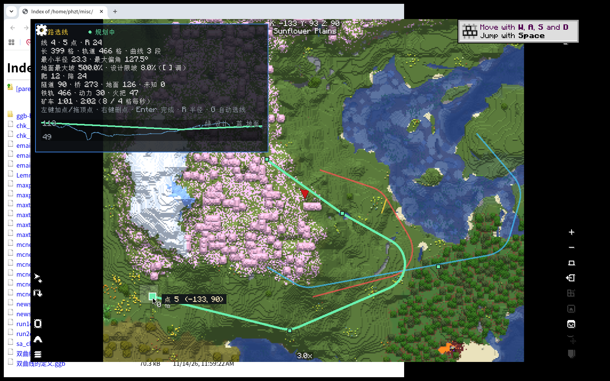
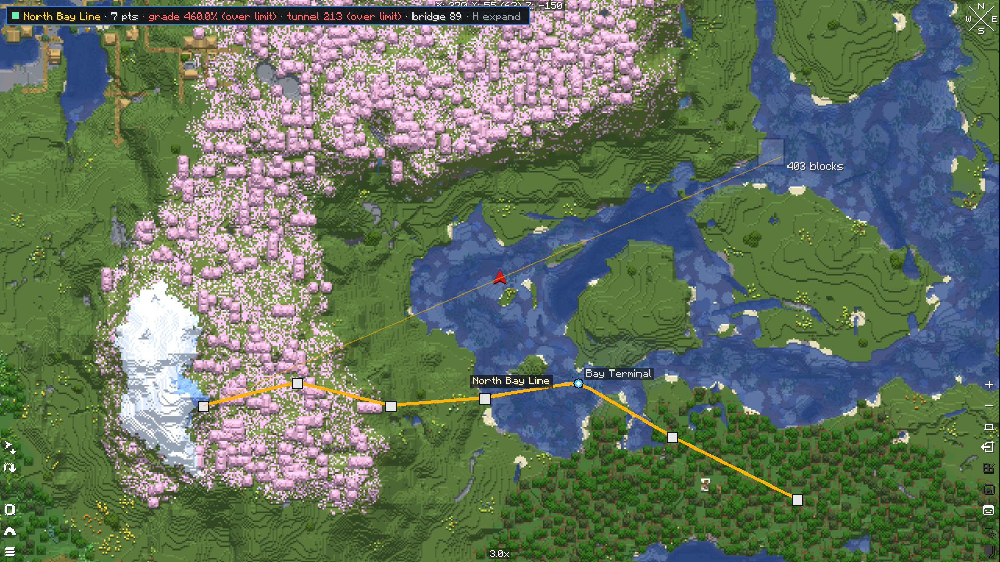
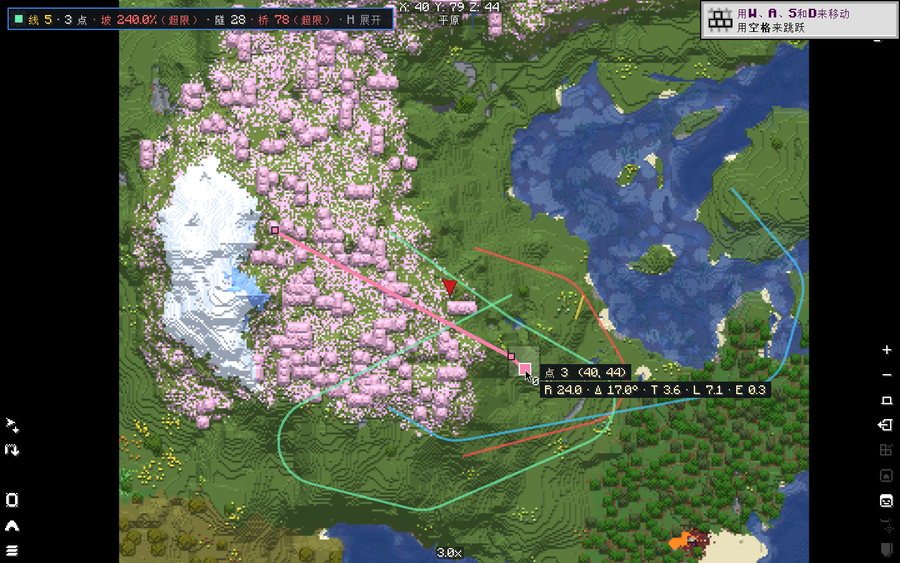

# Rail Planner · User Manual

This manual is not a feature list. It answers three things only: **how to use it**, **what every number on the panel means**, and **what is wrong when pressing something does nothing**.

- First time here → [§2 Five-minute start](#2-five-minute-start)
- Just want to read the panel → [§3 Reading the panel](#3-reading-the-panel-expanded)
- Want to change radius or grade → [§6 The three parameters that actually change the result](#6-the-three-parameters-that-actually-change-the-result)
- Something went wrong → [§11 FAQ](#11-faq)

---

## 1. What it is actually drawing

This is the thing people get wrong most often, so let's get it out of the way: **the points you click are not the track, they are the "centreline".**

That is how real railways are built too: fix a handful of control points on the drawing, join them into a polyline (that is the centreline), insert a circular curve at every corner, and only then put it on the ground. This mod does the first two steps:

```
What you click:  A ──────── B ──────── C        a polyline, the kind that pokes you
What it draws:   A ────╮       ╭──── C        every corner becomes a circular curve
                       ╰─────────╯
What you lay:    one block at a time along that curve
```

So:

- **Don't try to click every bend** — the denser you click, the less room there is for a circular curve (the next section explains why), and the less smooth the line gets.
- In the end the mod cuts it into an **8-connected string of blocks**, and that is the running line you can lay block by block.
- It **does not lay anything for you**, does not change the world, and does not sync over the network. The line only exists on your own client; nobody else can see it.

Technically it reads **the height data Xaero's World Map has already stored**: it doesn't load chunks, doesn't read the save file, and doesn't touch the network.

---

## 2. Five-minute start

### Install

1. Minecraft **26.3** + **Fabric Loader 0.19.5** (Java 25 runtime)
2. The client must have **Fabric API** and **Xaero's World Map ≥ 1.47**
3. Drop `railplanner-0.6.1.jar` into the client's `mods/`; Mod Menu is optional (it works without it — press `U` for settings)
4. **The server side is optional**: drop the same jar into the server's `mods/`, no config changes. With it installed, data is stored per UUID on the server and comes back automatically when you change machines; without it, it is purely local, exactly like 0.5.0. The server **does not need Xaero** and needs no client mods either

### Use

1. Enter a world and press `B` — the world map pops up and "Rail Planner ● Planning（铁路选线 ● 规划中）" appears in the top-left corner
2. **Left-click three times** on the map; three points make a line and it is rounded immediately
3. Grab the middle point and drag it, and watch the curve follow (this is the step that builds intuition)
4. When it looks right, press `Enter` — the route is saved and the next click starts a new one
5. Press `B` to leave planning mode: the line is still there, it just can't be edited any more (so you can lay track against it)
6. `Esc` closes the map; go back into the world and lay block by block



One trick while laying: zoom the map past **1.2 pixels per block** and the mod draws that block string one block at a time, so laying against it never goes off by one.

---

## 3. Reading the panel (expanded)

The panel in the top-left corner is expanded by default and has at most eight rows. Every row has a defined meaning; none of it is a rough estimate:

| Row | Example | Meaning |
|---|---|---|
| 1 | `Route 1 · 3 pts · R 24` | Current route name, anchor count, circular-curve radius (blocks) |
| 2 | `Len 412 blocks · track 402 blocks · 2 curves` | Geometric length of the smoothed curve / **how many blocks of rail you actually lay** / how many circular curves were inserted |
| 3 | `Min radius 18.4 · max deflection 47.2°` | The tightest radius of all corners, and the sharpest turn angle |
| 4 | `Terrain max grade 12.4% (over limit) · design grade 8.0% ([ ] to adjust)` | The steepest point of the terrain itself / the grade you allow the line to be built at |
| 5 | `Climb 37 · drop 12` | Total climb and total drop of the design vertical profile (blocks) |
| 6 | `Tunnel 128 · bridge 40 · ground 210 · unknown 34` | Mileage in three classes, decided by a 4-block height difference |
| 7 | `Rail 402 · powered 26 · torches 41` | Material estimate |
| 8 | `Minecart 1:23 · 2:46 (8 / 4 blocks per second)` | Travel time at full-speed powered rail and at normal speed |

Below that is a **small grade-profile chart** (42 pixels high):

- **Blue line = ground**, read from the terrain height Xaero has stored
- **Green line = design**, a vertical profile that can be built within your grade limit
- The two ends are the highest / lowest elevation along this stretch

Once you can read this chart you have the main point: **the two lines together = you can lay it on the ground here; apart = you dig (blue on top) or you bridge (blue underneath).**

Row 3 is the one most easily skipped, and it is the direct evidence of whether your line is drawn well: too small a minimum radius, too sharp a deflection — the corners are simply harsh.

Hover over a vertex (within 7 pixels) to see its block coordinates; hover near a corner (within 22 pixels) to see that bend's `R / Δ / T / L / E` — radius, deflection, tangent length, curve length, external distance.

---

## 4. Reading the panel (collapsed)

If it gets in the way, press `H` and it folds into one line:

```
Route 1 · 3 pts · grade 9.2% (over limit) · tun 28 · br 68 (over limit) · unknown 8 · H to expand
```



The rules are simple:

- **Grade（坡）** above your design grade → red
- **Tunnel / bridge（隧道 / 桥）** more than **35%** of the classified length **and** more than **32 blocks** → red (both conditions have to hold, so short routes don't raise false alarms)
- **Unknown（未知）** (never explored) → orange, meaning the stats for this stretch are incomplete, not that the line is hard to build
- The little square on the left: **green = planning**, grey = read-only

Folding only affects the panel; the coordinate tooltip on a vertex and the `R / Δ / T / L / E` tooltip on a bend still pop up as usual.



This state is stored in the config file: **press it once and it stays collapsed**, across game restarts and other saves. To have it collapsed by default, set `hudCollapsed` to `true` in the config (see [§8](#8-config-file-and-saves)).

With the map closed there is a shorter version of the same bar in the top-left of the world (grade, tunnel and bridge only), and the 3D line is still there — see [§14](#14-the-3d-line-in-the-world).

---

## 5. Keys

| Default key | Name | What it does | When it works |
|---|---|---|---|
| `B` | Planner mode（规划模式） | In the world: open the map in planning mode. In the map: toggle planning / read-only | Global |
| Left click on the map | — | Add an anchor (snapped to the block grid) | Planning mode |
| Left-drag a vertex | — | Move that point | Planning mode |
| Right-click a vertex | — | Delete this one point (**the only way to delete a middle point**) | Planning mode |
| Left click on an existing line | — | Click within 6 pixels of a line to pick that line up and keep editing it | Planning mode |
| Double-click a vertex | — | Change that point's Y (elevation): type a number, Enter confirms, Esc cancels | Planning mode |
| Left-drag empty space | — | Pan the map as usual | Any state |
| `Enter` | Finish route（完成这条线） | Saves; the next click starts a new route | Planning mode |
| `Delete` | Remove last point（撤销最后一个点） | Removes the last point only; middle points can't go | Planning mode |
| `R` / `Shift+R` | Curve radius（圆曲线半径） | ×1.25 / ×0.8 (4–200 blocks) | Planning mode |
| `[` `]` | Design grade（设计限坡） | ∓1% (`Shift` makes it 5% at a time), 1–30% | Planning mode |
| `J` | Auto-route（自动选线） | Finds a path from the last point to the cursor | Planning mode, with at least one point placed |
| `H` | Collapse panel（折叠面板） | Toggles one line / expanded | Planning mode |
| `U` | Settings page（设置页） | Opens settings (update check, key bind entry) | In the world, with no screen open |
| `V` | 3D line in the world（世界里的 3D 线） | Master switch for the 3D line in the world | In the world, with no screen open |
| `X` | 3D line through terrain（3D 线穿山可见） | Normal occlusion / drawn on top of everything | In the world, with no screen open |
| `L` | Lock placed points（锁住已选的点） | Once locked, left-dragging a vertex no longer moves it (prevents slips) | In the map or in the world |
| `Esc` | — | Closes the map and saves automatically | In the map |

Once locked, left-clicking a vertex only pops up "point locked, it won't move（点已锁定，拖不动）" and the point stays where it is; right-click delete and `Delete` undo are unaffected.

### Rebinding keys

**Options → Controls → Key Binds → Rail Planner（选项 → 控制 → 按键绑定 → 铁路选线）** — all twelve keys are in there, and a change takes effect immediately.

The key letters shown in the panel and in the world **read the same bindings**, so if you change `B` to `K`, the hints turn into `K` on their own, with no restart needed.

Three of the defaults were picked after running into walls:

- `G` was meant for auto-route, but vanilla's "quick actions（快捷动作）" already owns it → moved to `J`
- `O` was meant for the settings page, but vanilla's "friends list（好友列表）" already owns it → moved to `U`
- `H` really does share a key with vanilla's `debug.showAdvancedTooltips`, but that one only takes effect inside `F3`, so normally pressing it does nothing and there is no conflict

Before rebinding something yourself, check `options.txt` for a collision, so two features don't end up fighting over one key.

---

## 6. The three parameters that actually change the result

Everything else is display and toggles; **only these three actually change the shape of the line**.

### 6.1 Circular-curve radius R (default 24 blocks)

`R` grows it, `Shift+R` shrinks it, range **4–200**, geometric steps (24 → 30 → 37.5 …).

Three things you have to know:

**① It is a property of the whole route, not of a single corner.** One press changes every corner on the route. Tuning just one corner — not possible; that is how the model is designed right now.

**② The actual radius gets squeezed down by the length of the legs on either side.** Fitting a circular curve into a corner means giving up a tangent length T = R·tan(Δ/2) on each side. The mod caps that tangent at **49% of the shorter leg**, then solves the radius back out (R = T ÷ tan(Δ/2)).

That produces three effects you will certainly run into:

- **Points too close, and the radius won't grow.** Two points only 20 blocks apart allow at most 9.8 blocks of tangent; on a 90° corner the radius is squeezed to 9.8 blocks and setting 200 changes nothing.
- **The sharper the turn, the smaller the radius you get.** For the same leg length, a gentle 30° bend fits a large radius while a hard 90° corner only fits a small one — because tan(Δ/2) got bigger.
- **When the radius is squeezed below 0.5 blocks, that corner gets no circular curve at all**, and what you see is a sharp corner.

> So "I pressed `R` a dozen times and nothing happened" is not a broken key: the neighbouring points are too close or the turn is too sharp. **Drag the points apart**, or use fewer points.

**③ A small radius = it hugs the centreline you clicked and corners hard; a large radius = smooth, but it visibly cuts the inside of the corner away.** In reality a large radius is a good thing; in the game, past a certain point, you'll find the line sitting further from the terrain you clicked — because the circular curve shaved the corner off.

"Min radius（最小半径）" on row 3 is the smallest value after squeezing; it is normal for it to disagree with the `R` on row 1.

### 6.2 Design grade (default 8%)

`[` lowers it, `]` raises it, `Shift` makes each press 5%, range **1%–30%**.

**One number changes four things at once:**

| Lower the grade | Raise the grade |
|---|---|
| Flatter profile, less climbing | The profile hugs the terrain |
| Longer tunnels and bridges | Shorter tunnels and bridges |
| "Grade (over limit)" turns red more easily | The red goes away (but you only relaxed the standard) |
| Lots of earthwork | Less earthwork, but steeper |

The 8% default is not arbitrary: in Minecraft a powered rail climbs about 1 block every 12, which works out to 8%. Set it to 4% and you are demanding "this whole stretch may only climb as slowly as plain rail", so tunnels explode — that is the mod honestly reflecting your demand, not a bug.

**What it does not affect:** the horizontal shape (where the line turns), and the "terrain max grade（地面最大坡）" number — how steep the ground is and how steep you allow the line to be are two different things.

---

### 6.3 Sampling point Y (defaults to the highest block)

Every point carries a Y, which is **the design elevation where the line passes that point**.

**Default**: at the moment you click, it takes **the height of the highest block** in that column (the ground surface without leaves, the same height the panel's "terrain max grade" uses). If that area hasn't been seen by the map yet and the chunk isn't loaded, it records **64** for now, and switches to the real height once Xaero has explored the area (or the chunk has been loaded).

**How to change it**: hover a vertex and **double-click**; an input box appears next to it:

| Key | Action |
|---|---|
| Digits / minus sign | Type (the box opens fully selected, so the first digit replaces the old value) |
| Backspace | Delete one character |
| Enter | Confirm |
| Esc | Cancel |
| Clicking elsewhere on the map | Same as Enter (confirm) |

A point you edited is marked "manual"; dragging it only changes its position, not its elevation. A point you didn't edit re-samples the ground height when dragged to a new position.

**How it shapes the line**: the vertical profile has to pass through these heights.

- **The height difference between two adjacent points fits the grade** (|ΔY| ≤ grade × distance): between them the profile hugs the terrain, clamped by the range each end allows at that grade, so it never goes over the limit.
- **It does not fit the grade**: both ends are hard-pinned, so satisfying both was never possible; that stretch runs as a straight line between the two points and "design max grade（设计最大坡）" on the panel turns red — **this grade is impossible**: either pull the points apart and move one lower, or raise the grade limit (`]`), or delete one of the points.

So with the default value equal to the ground height, the line basically still walks on the ground; change one Y by hand and that stretch is pushed up / pressed down to it.

> A common sight: one point on a summit, one at the foot of the hill, very close together, and the moment you change a Y the panel goes red all over. The maths isn't wrong — the grade you asked for simply exceeds the limit. Pull the points apart, or accept tunnels/bridges.

Code: `Anchor` (each point carries y, manual, resolved), `VerticalProfile` (pure geometry, unit-tested by `tools/vertical-check.sh`).

---

