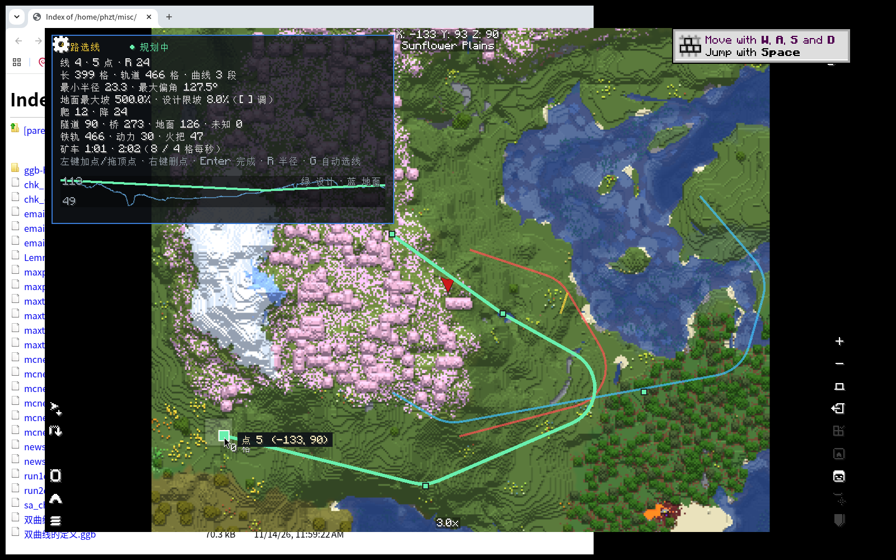
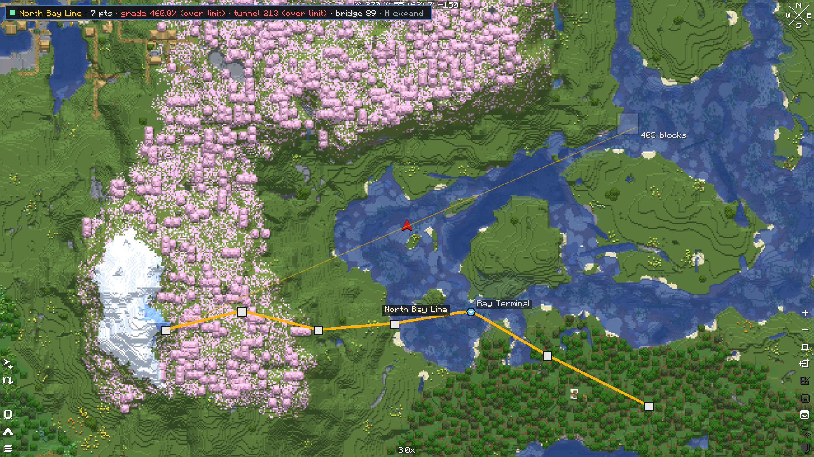
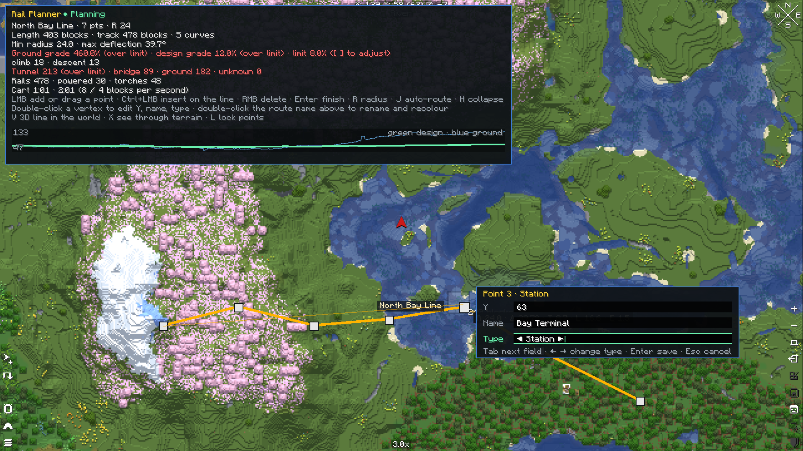
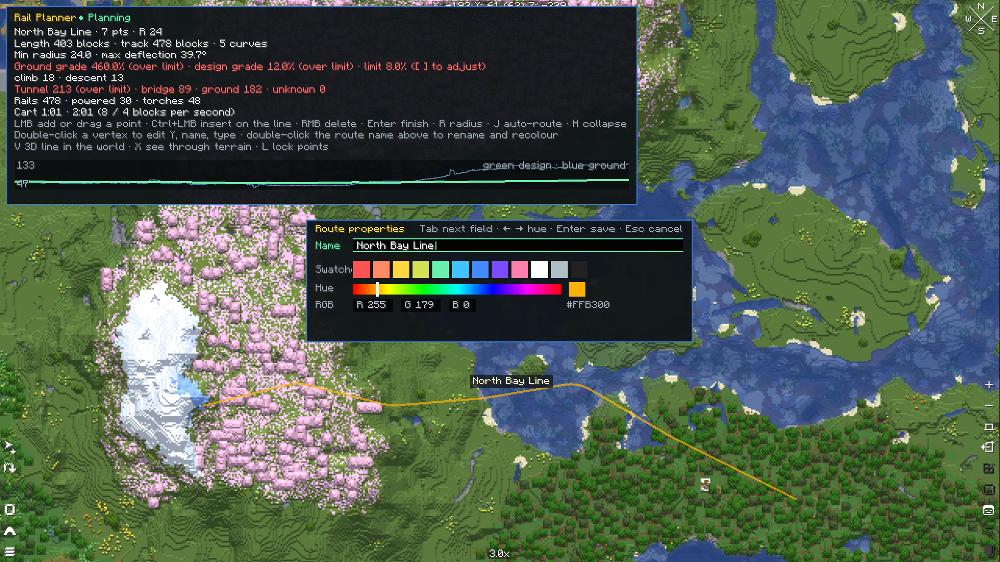
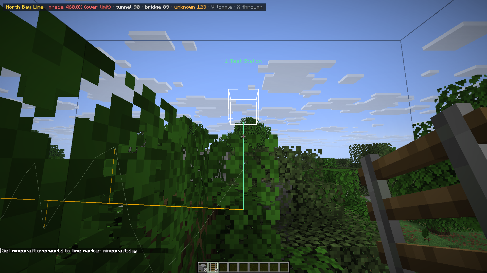
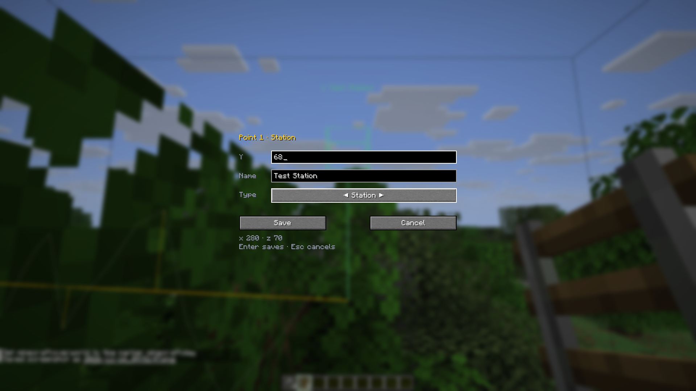
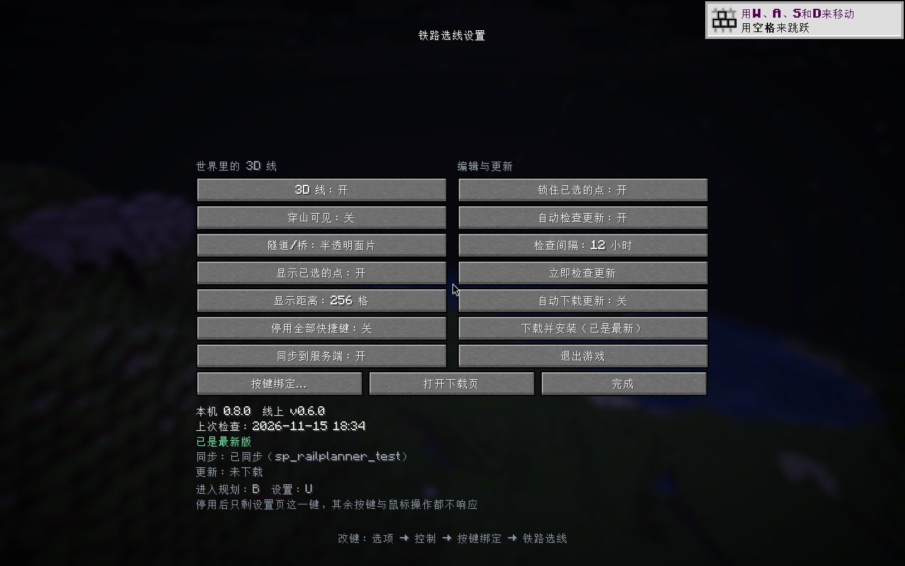
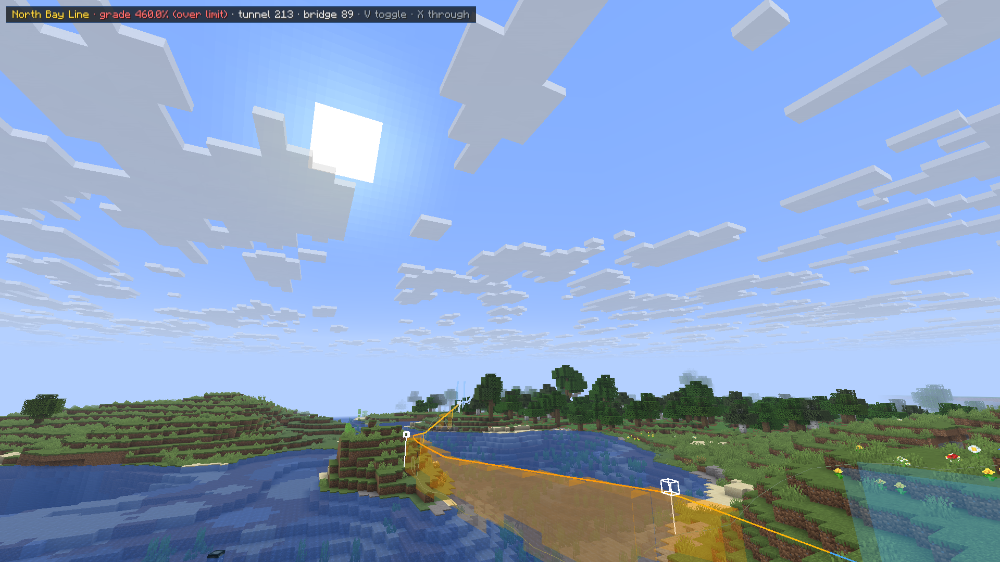
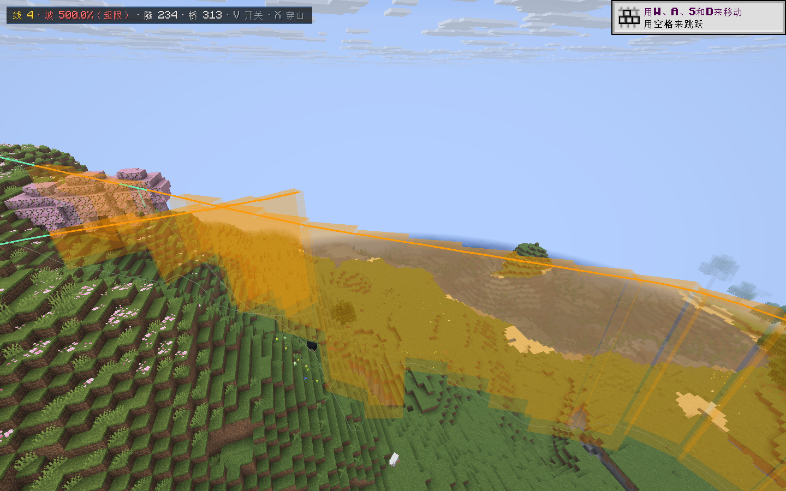

# 铁路选线 · 使用手册

[English](manual.en.md) · 中文

这份手册不列功能清单，只回答三件事：**怎么用**、**面板上每个数字是什么意思**、**按了没反应时是哪里不对**。

- 第一次用 → [§2 五分钟上手](#2-五分钟上手)
- 只想看懂面板 → [§3 面板怎么读](#3-面板怎么读展开版)
- 想改半径、限坡 → [§6 三个真正会影响结果的参数](#6-两个真正会影响结果的参数)
- 出问题了 → [§11 常见问题](#11-常见问题)

---

## 1. 它到底在画什么

这是最容易搞错的一件事，先说清楚：**你点的点不是轨道，是"导线"。**

现实里修铁路也是这么干的：先在图上定几个控制点，连成折线（这叫导线），然后在每个拐角插入圆曲线，最后才落到地面上。这个 mod 把前两步做完了：

```
你点的：A ──────── B ──────── C        折线，会扎人的那种
程序画的：A ────╮       ╭──── C        每个拐角换成圆曲线
                  ╰─────╯
铺的时候：一格一格铺在这条曲线上
```

所以：

- **别想着把每个拐弯都点到** —— 你点得越密，圆曲线越插不进去（下一节解释原因），反而画不出顺的线。
- 程序最后会把它切成一条 **8 邻接的方块串**，那就是你能一格一格铺出来的走行线。
- 它**不会帮你铺**、不会改世界、不会联机同步。线只存在你自己的客户端里，给别人看不了。

技术上它读的是 **Xaero 世界地图已经存下来的高度数据**，不加载区块、不读存档、不联网。

---

## 2. 五分钟上手

### 装

1. Minecraft **26.3** + **Fabric Loader 0.19.5**（Java 25 运行时）
2. 客户端必装 **Fabric API** 和 **Xaero's World Map ≥ 1.47**
3. 把 `railplanner-0.8.2.jar` 丢进客户端 `mods/`，Mod Menu 可选（不装也能用，按 `U` 开设置）
4. **服务端想装就装**（可选）：同一个 jar 丢进服务端 `mods/`，不用改配置。装了之后数据按 UUID 存到服务端、换机器自动拉回来；不装就是纯本地，跟 0.5.0 一样。服务端**不需要 Xaero**，也不需要任何客户端模组

### 用

1. 进世界，按 `B` —— 世界地图弹出，左上角出现「铁路选线 ● 规划中」
2. 在地图上**左键点三下**，三点成一条线，立刻圆角化
3. 按住中间那个点拖一下，看曲线怎么跟着变（这一步最能建立直觉）
4. 想在某两点之间加一个点：按住 `Ctrl` 点那条线，光标落在哪儿就插在哪儿
5. 满意了按 `Enter` —— 这条线存盘，下一个点自动开一条新线
6. 按 `B` 退出规划模式，线还在，只是点不动了（方便你对着铺）
7. `Esc` 关地图，回游戏里一格一格铺



铺的时候有个小技巧：地图放大到 **1.2 像素/格以上**，程序会把那条方块串直接画成一格一格的，对着铺不会错位。

---

## 3. 面板怎么读（展开版）

左上角那块面板默认是展开的，最多八行。每行都有明确口径，不是随便估的：

| 行 | 例子 | 什么意思 |
|---|---|---|
| 1 | `线 1 · 3 点 · R 24` | 当前线名、锚点数、圆曲线半径（格） |
| 2 | `长 412 格 · 轨道 402 格 · 曲线 2 段` | 平滑曲线的几何长度 / **实际要铺多少格铁轨** / 插了几段圆曲线 |
| 3 | `最小半径 18.4 · 最大偏角 47.2°` | 所有拐角里最紧的那个半径、最急的那个转角 |
| 4 | `地面最大坡 12.4%（超限） · 设计限坡 8.0%（[ ] 调）` | 地形本身最陡处 / 你允许修出来的坡度 |
| 5 | `爬 37 · 降 12` | 设计纵断面的总爬升、总下降（格） |
| 6 | `隧道 128 · 桥 40 · 地面 210 · 未知 34` | 按 4 格高差判出来的三段里程 |
| 7 | `铁轨 402 · 动力 26 · 火把 41` | 材料估算 |
| 8 | `矿车 1:23 · 2:46（8 / 4 格每秒）` | 满速动力铁轨与普通速度各跑一遍的时间 |

下面还有一个**坡度曲线小图**（42 像素高）：

- **蓝线 = 地面**，读的是 Xaero 存的地形高度
- **绿线 = 设计**，是按限坡修得出来的一条纵断面
- 左右两端是这段线上的最高 / 最低海拔

看懂这个图就抓住了重点：**两条线贴在一起 = 这段可以就地铺；分得开 = 要挖（蓝在上）或者要架桥（蓝在下）。**

第 3 行最容易被忽略，但它才是"你的线画得好不好"的直接证据：最小半径太小、最大偏角太急，就是拐得太生硬。

鼠标停在折点上（7 像素内）显示它的方块坐标；停在一个拐角附近（22 像素内）显示这个弯的 `R / Δ / T / L / E` —— 也就是半径、偏角、切线长、曲线长、外距。

---

## 4. 面板怎么读（折叠版）

嫌挡画面就按 `H`，收成一行：

```
线1 · 3 点 · 坡 9.2%（超限） · 隧 28 · 桥 68（超限） · 未知 8 · H 展开
```



规则很简单：

- **坡**超过你的「设计限坡」→ 红字
- **隧道 / 桥**占已判长度超过 **35%**、而且本身超过 **32 格** → 红字（两个条件都要满足，免得短线上误报）
- **未知**（没探索过）→ 橙字，表示这一段统计不全，不代表路难修
- 左边那一小格颜色：**绿 = 规划中**，灰 = 只读

折叠只影响面板，鼠标停在顶点上的坐标提示、停在弯道上的 `R / Δ / T / L / E` 提示照常弹。


这个状态记在配置文件里，**按一次就一直是折叠的**，重进游戏、换存档都不变。想让它默认就是折叠，把配置里的 `hudCollapsed` 改成 `true`（见 [§8](#8-配置文件与存档)）。

地图关掉以后，世界里的左上角还有一条更短的同款小条（只显示坡、隧道、桥），立体线也还在——见 [§14](#14-世界里的-3d-线)。

---

## 5. 按键

| 默认键 | 名字 | 干什么 | 什么时候有效 |
|---|---|---|---|
| `B` | 规划模式 | 在世界里按 = 开地图并进规划；在地图里按 = 规划 / 只读切换 | 全局 |
| 左键点地图 | — | 加一个锚点（吸附到方块） | 规划中 |
| `Ctrl` + 左键点在线上 | — | 在那两个点之间**插**一个点，位置吸附到线上最近的一点（线形不变） | 规划中 |
| 左键拖顶点 | — | 移动这个点 | 规划中 |
| 右键点顶点 | — | 删这一个点（**删中间的点只能这么删**） | 规划中 |
| 主手拿触发物品 + 右键对准点位 | — | 在世界里直接改这个点的 **Y / 名字 / 类型**：同一个框，只在准星对着那根竖针时生效（见 [§6.5](#65-在世界里右键改点位)） | 世界里（地图没开） |
| 左键点已有线 | — | 6 像素内点到线，把那条线捡回来继续编辑 | 规划中 |
| 双击顶点 | — | 改这个点的 **Y / 名字 / 类型**：三行框，`Tab` 换行、`←` `→` 换类型、回车保存、Esc 取消 | 规划中 |
| 双击面板上那行线名 | — | 改这条线的**名字和颜色**：色板点一下、色相条拖一下，或者填 RGB | 规划中 |
| 左键拖空白 | — | 照旧平移地图 | 任何状态 |
| `Enter` | 完成这条线 | 存盘，下一点自动开新线 | 规划中 |
| `Delete` | 撤销最后一个点 | 只删最后一个，删不了中间的 | 规划中 |
| `R` / `Shift+R` | 圆曲线半径 | ×1.25 / ×0.8（4–200 格） | 规划中 |
| `[` `]` | 设计限坡 | ∓1%（`Shift` 一次 5%），1–30% | 规划中 |
| `J` | 自动选线 | 从最后一个点到鼠标位置自动找路 | 规划中，且已有至少一个点 |
| `H` | 折叠面板 | 一行 / 展开切换 | 规划中 |
| `U` | 设置页 | 打开设置（更新检查、按键入口） | 世界里（没开任何界面时） |
| `V` | 世界里的 3D 线 | 世界里那条立体线的总开关 | 世界里（没开任何界面时） |
| `X` | 3D 线穿山可见 | 正常遮挡 / 画在所有东西之上 | 世界里（没开任何界面时） |
| `L` | 锁住已选的点 | 锁上之后左键按住顶点不会再拖动（防误触） | 地图里、世界里都行 |
| `Esc` | — | 关地图，自动存盘 | 地图里 |

锁上以后左键点到顶点只会弹一句「点已锁定，拖不动」，点还在原地；右键删、`Delete` 撤销都不受影响。

### 改键

**选项 → 控制 → 按键绑定 → 铁路选线**，十二个键全在里面，改完立刻生效。

面板和图里显示的按键字母是**读同一份绑定**的，所以你把 `B` 改成 `K`，提示字自动跟着变成 `K`，不用重开游戏。

三个默认键是踩过坑挑出来的：

- `G` 想给自动选线，但被原版「快捷动作」占了 → 改用 `J`
- `O` 想给设置页，但被原版「好友列表」占了 → 改用 `U`
- `H` 确实和原版 `debug.showAdvancedTooltips` 同键，但那个只在 `F3` 里生效，平时按没反应，不冲突

自己改键前建议先看一眼 `options.txt` 有没有占用，省得两个功能抢一个键。

---

## 6. 三个真正会影响结果的参数

其他都是显示和开关，**真正会改变线形的只有这三个**。

### 6.1 圆曲线半径 `R`（默认 24 格）

按 `R` 放大、`Shift+R` 缩小，范围 **4–200**，几何级数（24 → 30 → 37.5 …）。

三件事必须知道：

**① 它是整条线的属性，不是单个拐角的。** 按一下，这条线上所有拐角一起变。想只调一个拐角——做不到，现在的模型就是这么设计的。

**② 实际半径会被两侧线段长度压下来。** 拐角处要插圆曲线，得在两侧各让出一段切线长 T = R·tan(Δ/2)。程序限制这段切线最多吃掉**较短那条边的 49%**，再反算出半径（R = T ÷ tan(Δ/2)）。

这带来三个你一定会遇到的现象：

- **点太密，半径上不去。** 两个点只隔 20 格，切线最多 9.8 格；拐 90° 时半径就被压到 9.8 格，你设 200 也没用。
- **拐得越急，能用的半径越小。** 同样的边长，30° 的缓弯容得下大半径，90° 的硬拐只能用小的 —— 因为 tan(Δ/2) 变大了。
- **半径被压到 0.5 格以下时，那个拐角干脆不做圆曲线**，你看到的就是个尖角。

> 所以「我按了半天 `R` 怎么没反应」不是按键坏了，是相邻点太近或者拐太急。**把点拖远**，或者少点几个点。

**③ 小半径 = 贴着你点的导线走、拐得急；大半径 = 顺滑，但会明显切掉拐角内侧。** 现实里半径大是好事；游戏里半径大到一定程度，你会发现线离你点的地形高差变远了——因为圆曲线把拐角削掉了。

面板第 3 行的「最小半径」就是实际生效后的最小值，跟第 1 行的 `R` 对不上是正常的。

### 6.2 设计限坡（默认 8%）

`[` 调低、`]` 调高，`Shift` 一次 5%，范围 **1%–30%**。

**一个数字同时改四件事：**

| 限坡调低 | 限坡调高 |
|---|---|
| 纵断面更平，爬升更少 | 纵断面贴着地形走 |
| 隧道和桥变长 | 隧道桥变短 |
| 「坡（超限）」更容易标红 | 红字消失（但你只是放宽了标准） |
| 土方量大 | 省土方但坡陡 |

默认 8% 不是随便定的：Minecraft 里动力铁轨大概每 12 格能升 1 格，换算就是 8%。你把它调到 4%，等于要求"这一段全程只能像普通铁轨那样慢慢爬"，隧道会暴涨——这是它在如实反映你的要求，不是 bug。

**它不影响什么：** 不影响平面线形（怎么拐），也不影响「地面最大坡」那个数——地面坡是地形自己有多陡，跟你允许修多陡是两回事。

---

### 6.3 采样点的 Y（默认取最高方块）

每个点都带一个 Y，也就是**线路走到这一点时的设计标高**。

**默认值**：点下去那一刻，取这一列**最高方块的高度**（不含树叶的地表，和面板上「地面最大坡」用的是同一个高度）。那一带地图还没探到、区块也没加载，就先记 **64**，等 Xaero 探明那一带（或者区块加载过）再自动换成真实高度。

**改法**：鼠标停到顶点上**双击**，旁边会冒出一个框，第一行就是 `Y`：数字/负号输入（打开时是全选，敲第一个数字就把原值换掉）、退格删一个、`回车` 保存、`Esc` 取消、点地图别处也等于保存。同一个框里还有 `名字` 和 `类型` 两行，见 [6.4](#64-点的名字类型与线路颜色)。



改过的点标「手填」，拖它只换位置、标高不变；没改过的点拖到新位置会重新取地面高度。

**它怎么影响线形**：纵断面必须从这些高度上过。

- **相邻两点的高差放得进限坡**（|ΔY| ≤ 限坡 × 两点距离）：两点之间贴着地形走，但被两头按限坡追出来的范围夹住，不会超限。
- **放不进限坡**：两头都是硬钉住的，本来就不可能同时满足，于是这一段按两点之间的直线走，面板上的「设计最大坡」标红——**这是办不到的坡**：要么把点拉开、挪低，要么把限坡调高（`]`），要么删掉其中一个点。

所以默认值就是地面高度时，线基本还贴着地面走；手动改一个 Y，那一段线就被抬/压过去。

> 常见现象：两个点一个在山顶、一个在山脚，离得很近，一改 Y 面板就红成一片。不是算错，是你要的坡本来就超过限坡——把点拉远，或者接受隧道/桥梁。

代码：`Anchor`（每个点带 y、manual、resolved）、`VerticalProfile`（纯几何，`tools/vertical-check.sh` 单测）。

### 6.4 点的名字、类型与线路颜色

**点的名字和类型**都在双击顶点那个框里改，框里三行：

| 行 | 怎么改 |
|---|---|
| `Y` | 数字键输入、退格删；打开时是全选，敲第一个数字就换掉原值 |
| `名字` | 直接打字（ASCII 走按键、汉字走输入法或 `Ctrl+V` 粘贴），最多 24 个字 |
| `类型` | `←` `→` 换，六种见下表 |

`Tab` / `Shift+Tab`（或 `↑` `↓`）在三行之间跳，`回车` 保存，`Esc` 取消，点地图别处也等于保存。

类型决定点和名字在地图上、世界里的画法：

| 类型 | 图标 | 用在哪 |
|---|---|---|
| 普通点 | 白色小方块 | 就是个折点 |
| 车站 | 蓝色圆点 | 站台、会让站 |
| 弯道控制点 | 紫色菱形 | 只是让线在这里拐一下，不带工程设施 |
| 隧道口 | 橙色三角 | 进洞 / 出洞 |
| 桥梁 | 青色横杠 | 跨河、跨谷 |
| 信号机 | 红色叉 | 闭塞分界、会让点 |

名字留空就显示「点 N」；填了名字的点，鼠标停上去第一行是名字，地图上（放到 0.4 像素/格以上）把名字挂在点旁边，世界里的 3D 标签也带上它。

**线路的名字和颜色**：双击面板上那行线名（「线 4 · 6 点 · R 24」）弹出线路属性框。

| 行 | 怎么改 |
|---|---|
| `名字` | 打字，最多 24 个字 |
| `色板` | 12 个预设色，鼠标点一下就是那个色；`←` `→` 按 5° 转色相 |
| `RGB` | `←` `→` 选通道，数字键填 0–255 |

`Tab` 在三行之间转，鼠标也可以直接点色块和色相条。面板折叠之后，折叠那一行上的线名同样能双击。



新线不用自己挑颜色：按创建顺序从 7 色里取一个，改过之后跟着这条线走（存盘、同步都带）。

### 6.5 在世界里右键改点位

同一个框，第二个入口：**主手拿着触发物品（默认铁轨），准星对准世界里的那根点位竖针，右键。**

准星进到那根针 0.8 格以内、沿视线不超过 6 格才算命中；几个点挨得近时取视线最近的那个。命中时那个点会先套上一个**白框**——右键之前就知道要改的是哪一个；没对准就是普通的右键，方块照放、铁轨照铺。手里不是触发物品时这一行完全不生效。



框里还是那三样，只是外面那一圈换成了按钮：

| 行 | 怎么改 |
|---|---|
| `Y` | 数字键输入、退格删；打开时全选，敲第一个数字就换掉原值 |
| `名字` | 直接打字（汉字走输入法或 `Ctrl+V` 粘贴），最多 24 个字 |
| `类型` | 点一下换下一个（六种，见 [§6.4](#64-点的名字类型与线路颜色)） |



`Tab` 在 `Y` 和 `名字` 之间跳，`回车` 或「保存」落盘，「取消」或 `Esc` 不动数据。保存走的是地图里那个框**同一条路**（`Planner.applyAnchorEdit` + `saveNow`），改完立刻写文件并同步，不会出现「世界里改的、地图里看不到」。

**三个前提**（缺一个，右键就只是右键）：

| 前提 | 在哪 |
|---|---|
| 「拿物品右键改点」开着 | 设置页左栏，配置 `poiEdit`，默认开 |
| 「显示已选的点」开着 | 点根本没画出来，自然也点不到 |
| 「停用全部快捷键」没开 | 那个开关一开，本模组所有鼠标操作一起停 |

触发物品也能换：设置页左栏「触发物品」输入框里填物品 id（`minecraft:rail`、`minecraft:stick`……），不写命名空间按 `minecraft:` 补，离开设置页时落一次盘。

几个边界：

- **只有画出来的点才点得到**：地图关掉、3D 线开着、当前那条线上有点——和 [§14](#14-世界里的-3d-线) 画点是同一个条件
- **只改点，不挪点**：框里没有 x/z，右键不会把点拖走
- 命中判断是按那根**竖针**算的（和 §14 画的是同一根），所以对着针，不是对着地面上的那个方块
- 开框到保存之间，这条线要是被另一台机器同步换了（点的 x/z 变了），这次保存会直接放弃——宁可这次白改，也不改错一个点

---

## 7. 设置页、自动检查更新与自动安装

按 `U`（或 Mod Menu 里的齿轮）打开：



页面是两栏加一行底栏：左栏**世界里的 3D 线**，右栏**编辑锁定 / 同步 / 更新**。

| 左栏 | 作用 |
|---|---|
| 3D 线：开 / 关 | 世界里那条立体线的总开关，等价于按 `V` |
| 穿山可见：开 / 关 | 画在所有东西之上，等价于按 `X` |
| 隧道/桥：半透明面片 / 立柱 | 隧道和桥怎么画：面片是两侧挡墙 + 走廊底，立柱是每隔 8 格一根竖线 |
| 显示已选的点：开 / 关 | 编辑时把每个点画成一根带小旗和序号的竖针 |
| 显示距离：64 / 128 / 256 / 512 / 1024 格 | 点一下循环切，超出这个距离的线、面片、点都不画 |
| 停用全部快捷键：开 / 关 | 本模组的按键与鼠标操作**一起停**（防和别的模组抢键）。停用期间只剩「打开设置页」那个键还能用——不然就再也开不回来了。状态写进配置，重启也保持 |
| 同步到服务端：开 / 关 | 关掉就只用本地，**一个同步请求都不发**；服务端没装时这行只是记个心愿（见 §15） |
| 拿物品右键改点：开 / 关 | 主手拿着下面那个物品、准星对着世界里的点位右键，弹出同一个编辑框（见 [§6.5](#65-在世界里右键改点位)）；默认开 |
| 触发物品：`minecraft:rail` | 触发物品的 id，不写命名空间按 `minecraft:` 补；离开设置页时落盘 |

| 右栏 | 作用 |
|---|---|
| 锁住已选的点：开 / 关 | 锁上之后左键按住顶点不再拖动，等价于按 `L` |
| 自动检查更新：开 / 关 | **关掉就一个网络请求都不发** |
| 检查间隔：6 / 12 / 24 / 48 小时 | 点一下循环切，默认 12 |
| 立即检查更新 | 不看开关和间隔，马上查一次 |
| 自动下载更新：关 / 开 | **默认关**。「下载并安装」要你自己点；打开它才会查到新版本就自动下载、校验、就地替换 `mods` 里的 jar（见 §16） |
| 下载并安装 vX.Y.Z | 自动下载关掉时的手动那一下；已是最新时显示「（已是最新）」 |
| 退出游戏 | 就是正常退出（会存档）。装好新版本时按钮写成「退出游戏以应用新版本」，重启由你从启动器点 |

底栏三个按钮：**按键绑定… ｜ 打开下载页 ｜ 完成**。

按钮下面最多五行状态：

`@
本机 0.7.0　线上 v0.7.0
上次检查：2026-11-15 18:25
已是最新版
同步：已同步（mp_localhost）
更新：未下载
`@

| 行 | 怎么读 |
|---|---|
| 本机 / 线上 | 本机是 jar 里的版本，线上是 GitHub 上最新 release |
| 上次检查 | 改配置里的 `lastCheckEpochMs` 为 0 等于「从没查过」，下次进世界立刻查 |
| 状态 | **绿 = 最新 / 黄 = 有新版本 / 红 = 检查失败（后面跟原因）/ 灰 = 正在查** |
| 同步 | 未连接 / 同步中… / 已同步 / 服务端没装，只用本地 / 有冲突待选 / 同步已关（括号里是这个世界在同步里的身份） |
| 更新 | 未下载 / 正在下载 / 已装好待重启 / 更新失败（后面跟原因） |

### 检查是什么时候跑的

进世界后查一次，之后每 5 分钟看一眼到没到期。查到新版本会在聊天栏打一行，**点那一行直接开下载页**；同一版只提示一次，不会天天念。

请求只有一个 `GET https://api.github.com/repos/phzt-hub/railplanner/releases/latest`，带 `If-None-Match`：版本没变 GitHub 回 304，**不计入**未登录的 60 次/小时限流。除 `User-Agent: RailPlanner/<版本>` 外不发任何本机数据。

---

## 8. 配置文件与存档

### 8.1 配置：`config/railplanner.json`

```json
{
  "checkUpdates": true,
  "intervalHours": 12,
  "lastCheckEpochMs": 1763200000000,
  "lastEtag": "W/\"abc123\"",
  "latestVersion": "v0.3.0",
  "latestUrl": "https://github.com/phzt-hub/railplanner/releases/tag/v0.3.0",
  "hudCollapsed": false,
  "worldLines": true,
  "worldXray": false,
  "worldRange": 256.0,
  "worldSurfaces": true,
  "worldAnchors": true,
  "anchorLock": false,
  "poiEdit": true,
  "poiEditItem": "minecraft:rail",
  "hotkeysOff": false,
  "syncEnabled": true,
  "noModNotified": [],
  "autoUpdate": false,
  "pendingAssetUrl": "",
  "pendingSha256": "",
  "pendingSize": 0
}
```

| 字段 | 类型 | 能不能手改 | 说明 |
|---|---|---|---|
| `checkUpdates` | 布尔 | ✅ | 自动检查更新总开关 |
| `intervalHours` | 整数 | ✅ | 检查间隔，会被钳到 1–720；设置页只给 6/12/24/48 四档，手改可以填别的 |
| `hudCollapsed` | 布尔 | ✅ | `true` = 面板默认折叠成一行 |
| `worldLines` | 布尔 | ✅ | 世界里的 3D 线总开关，等价于按 `V`；默认开 |
| `worldXray` | 布尔 | ✅ | 3D 线穿山可见，等价于按 `X`；默认关 |
| `worldRange` | 浮点 | ✅ | 3D 线只画离镜头这么远以内的段（格），钳到 32–2048，默认 256 |
| `worldSurfaces` | 布尔 | ✅ | 隧道/桥用半透明面片画（`true`，默认）还是立柱（`false`） |
| `worldAnchors` | 布尔 | ✅ | 编辑时在世界里画已选的点；默认开 |
| `anchorLock` | 布尔 | ✅ | 锁住已选的点，等价于按 `L`；默认关 |
| `poiEdit` | 布尔 | ✅ | 主手拿着触发物品右键改点位的总开关；默认开 |
| `poiEditItem` | 字符串 | ✅ | 触发物品的物品 id；空着按 `minecraft:rail`，不写命名空间自动补 `minecraft:` |
| `hotkeysOff` | 布尔 | ✅ | 停用本模组全部快捷键与鼠标操作（防冲突）；设置页里那个开关写的就是它 |
| `syncEnabled` | 布尔 | ✅ | 与服务端同步总开关；`false` = 只用本地，一个同步请求都不发 |
| `noModNotified` | 字符串数组 | ✅ | 已经提示过「服务端没装」的世界身份；删掉哪条，那个服进一次就再提示一次 |
| `autoUpdate` | 布尔 | ✅ | 查到新版本就自动下载、校验、替换 `mods` 里的 jar；**默认 `false`**，设置页那个开关写的就是它 |
| `pendingAssetUrl` / `pendingSha256` / `pendingSize` | 字符串 / 长整数 | ❌ | 线上版本 jar 的地址、sha256、字节数，每次检查完自动写 |
| `lastCheckEpochMs` | 长整数 | ⚠️ | 上次检查时间戳，改成 0 等于"从没查过"（会立刻查一次） |
| `lastEtag` | 字符串 | ❌ | HTTP 缓存标记，手改会让下次多花一个请求 |
| `latestVersion` / `latestUrl` | 字符串 | ❌ | 上次查到的结果，"打开下载页"用它 |

删掉整个文件 = 全部回默认值。手改之前先把游戏关掉，否则退出时会被内存里的值覆盖。

### 8.2 存档：`railplanner/<世界身份>.json`

一个世界一个文件。**世界身份**从 0.6.0 起由模组自己算，不再用 Xaero 的存档标识：

| 场合 | 身份 | 例子 |
|---|---|---|
| 单人 / 局域网 | `sp_<存档文件夹名>` | `sp_railplanner_test` |
| 多人 | `mp_<主机名>`，**不带端口** | `mp_play.example.com` |

同一台服务器开在不同端口算**同一个**世界（数据共用一份）；不同主机名算两个世界，哪怕指向同一台机器。非法字符换成下划线，最长 64。

**老存档会自动迁过来**：0.5.0 及以前用的是 Xaero 的世界 id（单人像 `railplanner^us^test`，多人像 `Multiplayer_xxx`）。第一次用 0.6.x 进这个世界时，程序会把老文件里的线并进新名字的文件，日志里打一行「迁移旧存档 → …：N 条线」，老文件原样留着当备份。

`@json
{
  "version": 3,
  "world": "sp_railplanner_test",
  "routes": [
    {
      "id": "0f8c1e2a-...",
      "name": "线 1",
      "color": -52429,
      "radius": 24.0,
      "anchors": [[120, -340, 71, 2], [168, -332, 258, 2], [210, -300, 68, 0]],
      "anchorNames": ["", "东站", ""]
    }
  ]
}
`@

| 字段 | 说明 |
|---|---|
| `radius` | 这条线的圆曲线半径；写 0 或删掉会回落到 24 |
| `anchors` | 锚点 `[x, z, y, 标记位]`：`y` 是这个点的标高；标记位 bit0 = 手填、bit1 = 已经取到真实地面高度（0.7.0 起）、bit8 起是点的类型（0.8.0 起：0 普通点 / 1 车站 / 2 弯道控制点 / 3 隧道口 / 4 桥梁 / 5 信号机）。老存档只有 `[x, z]`，读进来当「还没解析」，地图一开就补上真实高度 |
| `anchorNames` | 与 `anchors` 同下标的点名字（0.8.0 起），空字符串表示没起名；老文件没有这一列 |
| `color` | 线条颜色（ARGB），新线按创建顺序从 7 色里取一个；双击面板线名可改 |
| `name` | 显示名 |

**什么时候写盘：** 改完最多 5 秒自动写一次；按 `Enter` 完成、拖动松手、关地图（`Esc`）都是立刻写。从服务端同步装进来的线也走同一条写盘路径。

删文件 = 清空这个世界所有线。也可以把这个文件拷给别人，他放进自己的 `railplanner/` 就能看到同样的线（高度是按他那份地形算的）。

### 8.3 同步基线与服务端存档

**基线**：`railplanner/sync/<世界身份>.json`，记「上次同步成功时每条线的内容指纹」+ 设置指纹。

`@json
{
  "version": "1",
  "worldKey": "mp_localhost",
  "settings": "e23a4c95...",
  "routes": {
    "0f8c1e2a-...": "9fb76f97...",
    "3a71c0d4-...": "c1a7e2b0..."
  }
}
`@

它**不参与渲染**，只用来判断「哪一边动过」。删掉它 = 这台机器当作第一次同步（下次会把两边的线并起来，同一条线内容不同时问你要哪边）。

**服务端存档**：一个玩家一个文件，里面按世界分桶。

`@
config/railplanner/players/<UUID>.json       # 专用服务端
<存档>/railplanner/players/<UUID>.json       # 单人 / 局域网，跟着存档走
`@

`@json
{
  "version": 1,
  "uuid": "6752491e-...",
  "updatedAt": 1794737689575,
  "settings": { "worldLines": true, "worldXray": false, "worldRange": 256.0,
                "worldSurfaces": true, "worldAnchors": true },
  "worlds": {
    "mp_localhost": {
      "routes": [ { "id": "...", "name": "线 1", "color": -52429, "radius": 24.0,
                    "anchors": [[0, 0], [40, 30]], "updatedAt": 1794737600000 } ],
      "deleted": { "另一个-id": 1794737500000 },
      "revision": 4
    }
  }
}
`@

| 字段 | 说明 |
|---|---|
| `worlds` | 按世界身份分桶，桶里是那条世界全部的线 |
| `deleted` | **墓碑**：这条线什么时候被删的，留 30 天。没有它，另一台没删过的机器下次同步会把它当「我独有」重新推上去，删掉的线就复活了 |
| `revision` | 每写一次 +1，只用来给人看和排查 |
| `settings` | 世界显示设置（全局一份，不分世界），见 §15 |

---

## 9. 那些数字的口径

不用背，但看懂了就不会误会面板在骗你。

| 数 | 怎么来的 |
|---|---|
| 长 | 平滑曲线的真实长度（含圆弧），不是折线长度 |
| 轨道 | 像素化后方块串的长度 —— **这才是要铺多少格铁轨** |
| 曲线 N 段 | 插了几段圆曲线，等于"有几个拐角成功圆角化" |
| 最小半径 | 所有拐角里被压缩后最小的那个，可能远小于你设的 `R` |
| 最大偏角 | 最急的转弯角度，45° 左右算正常，接近 90° 就是硬拐 |
| 地面最大坡 | 地形高度先做 5 格窗口平滑（抹掉树、柱子那种单格尖刺），再算相邻格最大高差 |
| 设计最大坡 | 纵断面（被点钉住之后）上相邻格的最大高差；超过设计限坡标红，见 [§6.3](#63-采样点的-y默认取最高方块) |
| 设计限坡 | 你自己设的，见 [§6.2](#62-设计限坡默认-8) |
| 爬 / 降 | 设计纵断面上的总上升、总下降 |
| 隧道 | 地面比设计标高高 **4 格以上** 的里程 |
| 桥 | 地面比设计标高 **低 4 格以上** 的里程 |
| 地面 | 高差在 ±4 格以内，可以直接铺 |
| 未知 | 那一格 Xaero 还没记录高度（没探索到） |
| 铁轨 | = 方块数 |
| 动力铁轨 | 每 16 格 1 个（`ceil`) |
| 火把 | 每 10 格 1 个（`ceil`），按你实际铺法可以减 |
| 矿车时间 | 按 8 格/秒（满速动力）与 4 格/秒各算一次 |

**为什么隧道/桥的判据是 4 格？** 差 1–2 格在 Minecraft 里根本不算桥也不算隧道，坡道就能接上；差 4 格以上，要么掏洞要么架柱子，工程性质变了。这个阈值是拍出来的经验值，写死在代码里（`RouteStats.java`），不在界面上。

**标红的三条判据**（同样写死在代码里，改要动 `PlannerRenderer.java`）：

1. 地面最大坡 > 设计限坡 + 0.05% → 「坡（超限）」
2. 隧道或桥 > 已判长度 × 35%，**且** > 32 格 → 「（超限）」
3. 未知 > 0 → 橙字

第 2 条为什么要两个条件：短线上 20 格桥就占一半，但那不叫工程大；32 格以上才值得重新考虑走法。

---

## 10. 一次完整示范

场景：想把铁路从山北的村子修到山南的港口，中间一道山脊，一条河。假设地图都探索过了。

**第一步：粗放三点，先看地形答不答应**

按 `B` 进地图，在村子、山脊、港口各点一下。别急着点满，就三个点。这时候面板已经在算了，先看两行：

- 「地面最大坡」如果 20% 以上——这山不管你多努力都得挖
- 坡度曲线如果蓝绿线分得很开——准备掏隧道

**第二步：让 `J` 试一条路**

把鼠标放到港口那边，按 `J`。程序按 8 格网格做 A*，坡度越陡越贵、跨水额外加价，自动给一条折线并简化成几个拐点。

不满意怎么办：按几下 `Delete` 把自动加的点一个个撤掉（它是在你最后那个点之后**追加**了一串拐点，起点还是原来那个），再手动补点。`J` 不是"替你决定"，是"给你一个可改的草案"。

**第三步：调 `R` 和限坡，观察代价**

按几次 `R` 放大半径。注意两个地方一起变：面板第 3 行「最小半径」往上走，同时线开始切掉拐角内侧——如果你正好要绕过山脊，切掉的那块可能就切进山体了，这时候该退一步把点往外挪，而不是继续加半径。

再看限坡：`[` 降到 5%，隧道立刻变长。这时候问自己一个问题，**"这条路将来跑不跑满载矿车"** —— 跑，就接受隧道；不跑，`]` 调到 10% 让它贴着山走更划算。

**第四步：定稿**

`Enter` 存盘。按 `B` 切只读，放大到 1.2 像素/格以上看方格，回游戏铺。

铺之前把面板第 7 行抄下来：铁轨、动力铁轨、火把的数量就是你的采购单。

**第五步：出门在 3D 里对一遍**

按 `Esc` 关地图（规划模式还开着），走到线路附近——线就在世界里立着，坡、隧、桥那条小条在左上角。拿不准哪段要挖，按 `X` 穿山：蓝色的立柱就是要挖掉的厚度，橙色的就是要架起来的高度（见 [§14](#14-世界里的-3d-线)）。看完按 `X` 关掉，免得走路挡视线。

---

## 11. 常见问题

**按 `B` 什么也没发生？**
不在世界里（主菜单里不生效）；或者没装 Xaero's World Map。地图已经开着的时候 `B` 是**切换规划/只读**，不重新开地图。

**面板显示「○ 只读」，点不动？**
再按一次 `B`。只读模式下所有线还显示，就是不能编辑——这是故意的，方便你对着铺。

**点空白处，结果把别的线捡起来了？**
你点在离某条线 6 像素以内了。往旁边挪一点，或者先按 `B` 退出再进。

**拖不动顶点？**
命中范围是 7 像素。地图缩得太小时，两个点会挤在一起点不准——**放大再拖**。另外，点是"按下-松开位移小于 5 像素"才算加点，你拖动地图时手抖一般不会误加点。

**按 `R` 半径没变？**
见 [§6.1 第 ② 条](#61-圆曲线半径-r默认-24-格)：相邻点太近，程序把半径压下来了。把点拖远。

**`J` 自动选线没反应？**
三种情况：① 还没有任何点（第一个点得自己点）；② 起点和终点在同一格；③ **跨度太大**——搜索框是起终点包围盒各外扩 224 格，里面 8 格一格的网格超过 24 万个（大约 3450 格见方）就直接放弃。分两段选。

**一堆「未知」？**
那块 Xaero 没探索过。走过去、或者开创造飞一圈让地图记下来，回来数字就有了。

**新版本提示不弹？**
设置页看状态行：关着开关、或者检查失败（红字会给原因，多半是连不上 GitHub）。「立即检查更新」不受开关和间隔影响。

**世界里看不到线？**

四个可能，按顺序排：① 这次进世界后还没按过 `B`（没进过规划模式就什么也不画）；② 按了 `V` 把它关了，左上角小条会写「3D 线关」；③ 手里没有「当前线」——去地图里点一下想看的那条（6 像素内）；④ 线离你超过 `worldRange`（默认 256 格）。

**线老是埋在土里，或者只看到一条暗绿的线？**

埋着就对了：8% 限坡把设计标高压到了地面以下，这一段就是隧道，设计线当然在地里。按 `X` 穿上来看，蓝色立柱的高度就是挖方。想让它贴地走路，把限坡调高（`]`）再看。

**`V` / `X` 按了没动静？**

这两个只在「世界里、没开着任何界面」时生效：聊天框开着、地图开着都不响应。

**升级 Xaero 之后游戏崩了？**
这个 mod 是对着 Xaero `1.47.x` 的内部类写的（`GuiMap` 那几个字段），Xaero 改结构就得跟着改 mixin。升级前先看 release 说明有没有跟上。

**面板挡住 Xaero 的按钮？**
按 `H` 折叠。0.3.0 已经把绘制顺序改到 Xaero 之后，左上角那排按钮不会再压住标题。

---

## 12. 已知限制

- 只读 **Xaero 已探索**的区域；没走过的地方记「未知」，自动选线也会给未知区域加价（但仍然是猜的）。
- 对着 Xaero **1.47.2** 写的，Xaero 升级后内部类名一变就得改 mixin。
- **只有单一半径圆曲线**，没有缓和曲线；纵断面只做限坡剖切，**没有竖曲线**（两个坡段之间是硬折角）。
- **一次只编辑一条线**；别的线只显示不动（点它的线可以捡回来编辑）。
- 半径是**整条线**共用的，不能单点调。
- 统计里的材料数是估算（动力铁轨 1/16、火把 1/10），实际铺法不同就会差。
- 3D 线的地面标高用的是 **Xaero 记的地表高度**（含树叶），树林上空会看到很陡的「地面坡」；地表以下的部分靠 `X` 穿山才看得见。
- 更新检查要能连上 GitHub；连不上就在设置页显示原因，不影响画线。
- 没装 Mod Menu 也能用：设置页走 `U`。
- **新版本要重启一次才生效**：Fabric 的类加载器和 mixin 都没法在运行中换掉，自动更新省的是「下载、校验、替换」，不是重启本身（见 §16）。
- 同步只比**内容**：同一条线两边各加了一个点算冲突，得自己选一边；不做逐点合并。
- 服务端只按 UUID 认玩家，**没有管理员命令**；想看谁的数据就去他的文件里看。
- 世界身份只认主机名，所以 `play.example.com` 和它的 IP 是两份数据；要换地址最好一开始就用域名。

---

## 13. 自己动手改

### 构建

```sh
./tools/fetch-xaero.sh     # 下载编译用的 Xaero 26.3 jar（不进仓库：Xaero 是 All Rights Reserved）
./tools/fetch-modmenu.sh   # 下载编译用的 Mod Menu（可选依赖，同样不进仓库）
./gradlew25 build          # 不要用 ./gradlew：全局 ~/.gradle/gradle.properties 把 JVM 钉在 java-21
./tools/make-icon.py       # 只改图标时跑：重新生成 assets/railplanner/icon.png（128×128，要 Pillow + numpy）
```

产物：`build/libs/railplanner-0.8.2.jar`。

### 自检与调试

```sh
./tools/geom-check.sh      # 圆曲线参数与像素化连续性，不启游戏
./tools/version-check.sh   # 版本号比较
./gradlew25 runClientTest  # 直接进 run/saves/railplanner_test（1440×900），方便无头截图
```

### 代码地图

| 文件 | 管什么 |
|---|---|
| `Planner.java` | 规划状态、点击/拖动/按键、自动选线的入口 |
| `RouteStats.java` | 长度、坡度、隧桥、材料、时间，以及**设计限坡**这个参数 |
| `RouteStore.java` | 存档读写 |
| `Anchor.java` | 一个点：x、z、y，以及「手填 / 已取到地面高度」两个标记 |
| `VerticalProfile.java` | 纵断面：把点钉在各自的 Y 上，两点之间按限坡夹地形、放不进限坡就走直线（纯几何，可单测） |
| `Alignment.java` | 折线 → 切线—圆曲线—切线 |
| `Rasterizer.java` | 曲线 → 方块串 |
| `AutoRouter.java` | `J` 的 A*（8 格网格、坡度 9 倍代价、跨水 +260、未知 +60） |
| `PlannerRenderer.java` | 面板、折叠行、坡度曲线、标红阈值 |
| `GuiMapMixin.java` | 挂进 Xaero 地图界面（画在它之后，否则按钮压标题） |
| `RouteGizmos.java` | 世界里的 3D 线：设计线、地面线、填挖立柱、穿山、距离剔除 |
| `DebugRendererMixin.java` | 借原版 `emitGizmos` 的时机把线塞进同一批 |
| `WorldHud.java` | 世界里那条一行状态条 |
| `XaeroTerrain.java` | 从 Xaero 读高度（读不到时退回真实区块） |
| `sync/SyncClient.java` | 客户端同步状态机：握手 → 拉取 → 合并 → 推送 → 签收基线 |
| `sync/SyncKeys.java` | 世界身份（`sp_<存档名>` / `mp_<主机名>`，不带端口） |
| `sync/SyncBase.java` | 同步基线读写（`railplanner/sync/` 下） |
| `sync/SyncConflictScreen.java` | 「同步冲突」窗口，一条线一个按钮 |
| `sync/Merge.java`（common） | 三方合并算法，纯函数，可脱离游戏单测 |
| `sync/PlayerStore.java`（common） | 服务端按 UUID 落盘，一个玩家一个文件 |
| `sync/ServerSync.java`（common） | 服务端三个处理器：握手 / 拉取 / 推送 |
| `update/Updater.java` | 下载 → sha256 校验 → 就地替换 jar（不重拉游戏，退出由玩家点） |

想调手感就改 `AutoRouter` 里那三个常数；想改标红就改 `PlannerRenderer` 顶上的 `TUNNEL_BRIDGE_WARN_SHARE` 和 `WARN_MIN_LENGTH`。
---

## 14. 世界里的 3D 线

地图上画完，关掉地图线还在——0.4.0 加的：把这条线画进三维世界，边走边对。0.5.0 又把隧道/桥从「一根根立柱」换成半透明的面片，编辑时还会把每个点标出来。



### 画了四样东西

| 元素 | 颜色 | 意思 |
|---|---|---|
| 设计标高线（粗） | 线本身的颜色，**隧道段蓝、桥段橙** | 轨道最后走的那一层 |
| 地面标高线（细） | 暗绿 | 沿线现在的地形 |
| 隧道/桥的面片 | 隧道蓝 / 桥橙，半透明 | 两侧挡墙 + 设计面走廊，围出「要挖 / 要架」的那一块体积 |
| 已选的点（只在编辑时） | 起点绿、终点红、中间白，锁住时压暗 | 每个点一根竖针：从地面/设计面里低的那头扎到高的那头，杆顶挑一个小方块，上面标序号 |

面片每段 8 格长、半宽 1.5 格。蓝色 = 地面在设计面之上（隧道，那一段从山肚子里过），橙色 = 地面在设计面之下（桥，那一段要架起来）。

编辑时每个点都会立一根这样的针——起点绿、终点红、中间白，杆顶的小方块上标着它是第几个点：


这几根针不只是装饰：主手拿着触发物品、准星对准其中一根右键，就弹出改这个点的框（见 [§6.5](#65-在世界里右键改点位)）——不用回地图。

两条线差多少，正好就是面板上「隧 612 · 桥 15」那些数字的来源——**同一份数据、同一个算法**，不是另算一套。

不想看面片：设置页左栏「隧道/桥」切到「立柱」，或者手改配置 `worldSurfaces: false`。立柱只会留给差得不够多、没被判成隧道/桥的零碎段落——那些地方没有面片可画。

### 什么时候出现

- **在世界里、规划模式开着**（按过 `B`）才出现，退出规划模式就没了
- 画的是「当前线」：正在编辑的那条；没在编辑就显示最后载入 / 选中的那条（所以按 `Enter` 完成之后它**不会**消失）
- **点只在编辑时画**：完成之后那条线是拿来照着修的，点不用再刷存在感
- 只画离镜头 `worldRange`（默认 256 格）以内的段

### 三个键

| 键 | 作用 | 记住状态 |
|---|---|---|
| `V` | 3D 线开 / 关 | 是（`worldLines`） |
| `X` | 穿山可见（画在所有东西之上） | 是（`worldXray`） |
| `L` | 锁住已选的点 | 是（`anchorLock`） |

三个开关在设置页里也各有一份，不记键位也能改。

`X` 打开后整条线连面片一起画在实体之上，山挡住了也看得见——隔着山判断挖方深度、对位、截图都靠它：



### 点的锁定

线画好以后最怕手一抖按住某个点拖一下——几何、半径、纵断面全跟着重算。按 `L` 锁上之后：

- 左键按住顶点不再拖动，点还在原地；地图下方中间会弹一句「点已锁定，拖动不会再移动」（世界里那条 HUD 被地图挡着，所以地图里另画一行，2.5 秒后自己消失）
- 地图面板右下角那行提示会变成「`L` 点已锁」（橙色），一眼能看出锁没锁
- 左键点空白照旧加点，右键删点、`Delete` 撤销照旧——锁的是「拖」，不是「改」
- 拿物品右键改点（[§6.5](#65-在世界里右键改点位)）也不受影响，同样是「改」不是「拖」
- 世界里那条状态条会多出「点已锁」，点本身也画暗一档
- 设置页右栏「锁住已选的点」是同一个开关

### 开销

一帧最多塞 1200 段线（`MAX_LINES`）+ 400 个面片（`MAX_FACES`），远的那头先丢；面片步长 8 格，一条 2 公里的线最多 250 段 × 3 面。点的开销跟点的个数成正比（每个点一个方块框、一根针、一个序号）。

实测（1440×900，llvmpipe 软渲染，无显卡加速）：同一条线、同一个机位，3D 线开着 11 fps，按 `V` 关掉也是 11 fps——测不出来。真显卡更不用担心。

### 它不做什么

- **不放方块、不改世界**：纯客户端绘制，退出游戏什么都不留
- 没有缓和曲线、没有竖曲线（跟面板的纵断面口径一致）
- **不跟着地形实时更新**：你之后挖了山，得在地图里动一下线（加点、拖点）才会重算标高

---

## 15. 双端同步（服务端那份）

### 装不装服务端，差别在哪

| | 服务端没装 | 服务端装了 |
|---|---|---|
| 数据存在哪 | 只有本地 `railplanner/<世界身份>.json` | 本地一份 + 服务端一份，两份都完整 |
| 换机器 | 要自己拷文件 | 进服自动拉回来 |
| 同一台服的多个玩家 | — | 每人（UUID）一份，互相看不见 |
| 聊天栏 | 进服提示一次「服务端没有装 Rail Planner，画好的线只保存在本地」 | 不提示 |

那个提示一台服务器只说一次，记在 `noModNotified` 里；嫌它烦就删掉里面那条，只会再提示一次。

### 什么算「同一台服务器」

**只认主机名，不认端口**：

- `play.example.com:25565` 和 `play.example.com:25566` 是同一台 → 共用一份数据
- `127.0.0.1` 和 `play.example.com` 是两台 → 各存各的（哪怕指向同一台机器）
- 单人 / 局域网：按**存档文件夹名**算，拷存档就把数据一起带走

世界身份长这样：`mp_<主机名>` / `sp_<存档名>`，非法字符换成下划线。它同时决定三件事：本地存档文件名、服务端里那个「世界桶」、同步基线文件名。

### 每次同步干什么

1. 进服握手（`railplanner:c2s` / `railplanner:s2c` 两条自定义通道）——问「你装了吗、协议几版」
2. 拉取这个玩家在这个世界的数据
3. **三方合并**：本地 / 上次同步的基线 / 服务端
4. 没冲突：把服务端独有的线装进本地、把本地独有的线推上去，然后签收基线
5. 有冲突：弹「同步冲突」窗口，一条一条选完再走第 4 步
6. 之后每次改动停手 3 秒再走一遍 2–5（**先拉再推**，这样两台机器同时改也判得出来）

### 冲突怎么判、界面怎么操作

判据只有两条：本地跟基线比变了没有、服务端跟基线比变了没有。**只有一边变就直接用那一边**，两边都变且内容不同才算冲突。

| 冲突类型 | 界面上写什么 | 选本地 | 选服务端 |
|---|---|---|---|
| 两边都改过 | 「两边都改过」 | 推本地这份上去 | 装服务端这份下来 |
| 你删了、服务端改过 | 「你删了，服务端改过」 | 重新推上去（复活） | 拉回来 |
| 服务端删了、你改过 | 「服务端删了，你改过」 | 推上去（复活） | 本地也删掉 |
| 世界显示设置两边都改 | 「世界显示设置」 | 推本地设置 | 用服务端设置 |

窗口里每条是一个按钮，点一下在「保留本地 / 保留服务端」之间切，**按钮上的字永远写「点了会怎样」**。底下一排：`全部保留本地` / `全部保留服务端` / `应用并同步` / `这次先不管`。默认立场是**保留服务端**（共享的那份），想留本地得自己点。超过 6 条会分页。

「这次先不管」不删任何数据，只是这轮不动手，下次进服还会再问。

### 服务端存哪、隔离怎么保证

一个玩家一个文件（结构见 §8.3）。服务端**只认连接里的 UUID**，请求正文里没有任何 UUID 字段，所以不存在「请求别人文件」这条路径；每个玩家的文件也只按自己的 UUID 读写。别人有几条线、几号版本，你的客户端一个字节都收不到。

### 关掉同步

设置页左栏最后一行「同步到服务端：开 / 关」，或把 `config/railplanner.json` 里 `syncEnabled` 改成 `false`。关掉之后一个同步请求都不发，行为跟 0.5.0 完全一样。

---

## 16. 自动更新（热更新到底能到哪一步）

先说结论：**Fabric 模组的代码换不了，重启这一步省不掉。**

### 为什么不能让新代码直接生效

- **类一旦加载就没有卸载**：Fabric 启动时把每个模组的类装进自己的类加载器，游戏跑到一半不存在「把这个类换掉」的接口。
- **mixin 是织进目标类的**：我们往 Xaero 的 `GuiMap`、原版 `DebugRenderer` 里插了代码（见 §13），插进去就跟着那个类活了，改不回来。
- **只剩字节码热替换这条路**：JVM 的 `Instrumentation.redefineClasses` 只允许改方法体、不能增删字段和方法，而且要在启动时带 `-javaagent`、自 attach 默认被 JDK 禁掉——对普通玩家不现实。

所以「热更新」能做到的是「除了重启都不用你动手」——而且默认连下载这一步都要你点一下，「自动下载更新」是关着的。

### 自动的是这几步

| 原来的手动步骤 | 现在 |
|---|---|
| 看到提示 → 开浏览器 → 找 release 页 | 后台直接下载 |
| 手动挑对的那个 jar | 按文件名挑 `railplanner-<版本>.jar`（同一个 release 里的 `-sources` 源码包也以 `.jar` 结尾，靠名字排除掉） |
| 担心下坏、下错 | **字节数 + sha256 双校验**，再开包确认主类在不在；任何一项不对就不替换 |
| 退出游戏、剪切、覆盖 | 就地替换，先写 `.new` 再改名 |
| 重新开游戏 | 面板上「退出游戏」退出，再从启动器进 |

### 重启那下不再由模组代劳

早先点「重启游戏」会读当前进程的完整命令行，用 `sh -c 'sleep 2; exec <那一行>'` 另起一个 JVM。这段代码已经删掉：模组自己去 exec 一遍启动命令，在哪个平台上都是木马的行为特征，杀软会直接拦，人工审核也会问；而 Fabric 的模组本来就得重启一次，从启动器点一下和自动拉起来对玩家没有区别。

现在装好之后只有一条路：**退出游戏 → 从启动器进**。设置页那颗按钮在装好之后变成「退出游戏以应用新版本」，点它就是正常退出（存档、放文件锁），不会替你重开。

- 重新进游戏回到的是**主菜单**，不会自动进世界。
- 装好还没重启时，设置页「更新：」那一行一直写着「vX.Y.Z 已装好，重启生效」。

### 不想让它自己下

默认就是「只提示 + 给下载页」：查到新版本只在聊天栏说一声，装不装由你点「下载并安装」那一颗。想让它查到就自己下，就把设置页右栏的「自动下载更新」打开（配置里 `autoUpdate: true`）。整条链彻底关掉则是把「自动检查更新」也关掉（那连请求都不发）。

---

## 17. 服务端自动更新（MCDR 插件）

仓库里的 `server-plugin/` 是给 **MCDReforged** 用的插件：客户端那套自动更新（§16）只管客户端，服务端以前得手工换 jar，这个插件把服务端也接上。

### 它做什么

每 `check_interval_minutes` 分钟查一次 GitHub release：

1. 找最新一个带 `.jar` 附件的 release（跳过 draft，默认连预发布一起跟）。**只认本体**：release 里还挂着 `railplanner-<版本>-sources.jar` 源码包，它同样以 `.jar` 结尾、sha256 与字节数也照样对得上，换上去服务端起不来（主类不在里面）。所以按名字找 `railplanner-<版本>.jar`，找不到就跳过这一版；
2. 和 `server/mods/` 里的 `railplanner-*.jar` 比版本，不比它新就什么都不做；
3. 新的话下载到 `mods/.railplanner-download.tmp`，按 GitHub 给的 **sha256 + 字节数**校验，还要能当 zip 打开；**再开包验一遍**——有没有 `fabric.mod.json`、主类 `com/phzt/railplanner/RailPlanner.class` 在不在、模组 id 与版本号对不对。任何一条不过就删掉临时文件、原样退出，`mods/` 里一个字节都不动；
4. 旧 jar 挪进 `mods/.railplanner-backup/`（`keep_backup`），换上新 jar；
5. `auto_restart` 开着且服务端在跑 → 聊天栏喊一句，`restart_delay_seconds` 秒后用 MCDR 自己的 `restart` 重启服务端；
6. 换完要盯到服务端打出 `Done` 才算成功。重启后没到 `Done` 就又停了（新 jar 起不来），就在这次的 stop 事件里把备份换回去并重新拉起服务端——得同步做完，因为 MCDR 的 `EXIT_AFTER_STOP` 在事件派发完就会让 MCDR 自己退出，等定时器再回滚已经晚了。

### 装

把 `server-plugin/` 打成一个 `.mcdr`（就是个 zip），丢进 MCDR 的 `plugins/`：

```sh
cd railplanner
bash tools/build-server-plugin.sh    # 出 build/railplanner_updater-<版本>.mcdr
```

版本号取自 `server-plugin/mcdreforged.plugin.json`；脚本用 python 的 `zipfile` 打包，本机没装 `zip` 也能出。

然后 `!!MCDR plugin load railplanner_updater`，或者直接重启 MCDR。第一次加载会生成 `config/railplanner_updater/config.json`。

### 配置

```json
{
  "enabled": true,
  "repo": "phzt-hub/railplanner",
  "check_interval_minutes": 30,
  "include_prerelease": true,
  "auto_restart": true,
  "restart_delay_seconds": 15,
  "keep_backup": true
}
```

| 字段 | 说明 |
|---|---|
| `enabled` | 总开关 |
| `repo` | 跟哪个仓库 |
| `check_interval_minutes` | 查一次隔多久，最小 5 |
| `include_prerelease` | 预发布也跟（默认跟） |
| `auto_restart` | 换完自动重启；关掉就只换 jar，下次重启生效 |
| `restart_delay_seconds` | 重启前留多少秒，最小 3 |
| `keep_backup` | 旧 jar 留一份在 `mods/.railplanner-backup/`，回滚直接换回去 |

### 命令

| 命令 | 权限 | 作用 |
|---|---|---|
| `!!railupdate` / `!!railupdate status` | 所有人 | 当前 jar、开关、间隔、上次结果 |
| `!!railupdate check` | 管理员 | 立刻查一次 |
| `!!railupdate on` / `off` | 管理员 | 开关自动更新（写回配置） |
| `!!railupdate reload` | 管理员 | 重读配置 |

注意：`!!railupdate check` 查到新版本时**也会按配置重启**；想只换不重启，先把 `auto_restart` 关掉再 check。

> 协议：0.7.0 起同步协议是 **2**（锚点带 Y）。0.6.x 的客户端连 0.7.0 服务端会显示「协议不兼容」，只用本地数据——两端要一起升。
